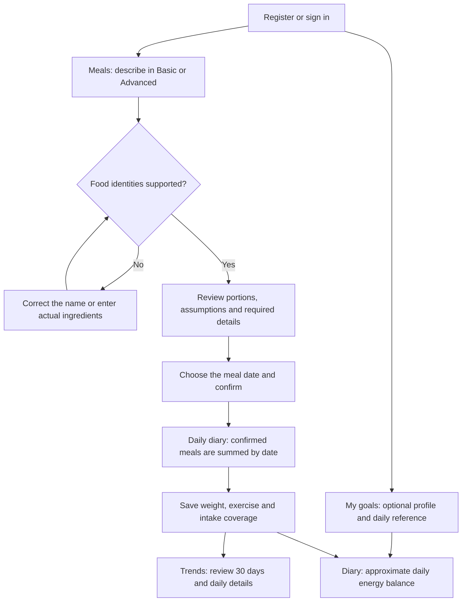
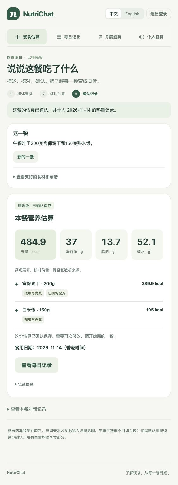
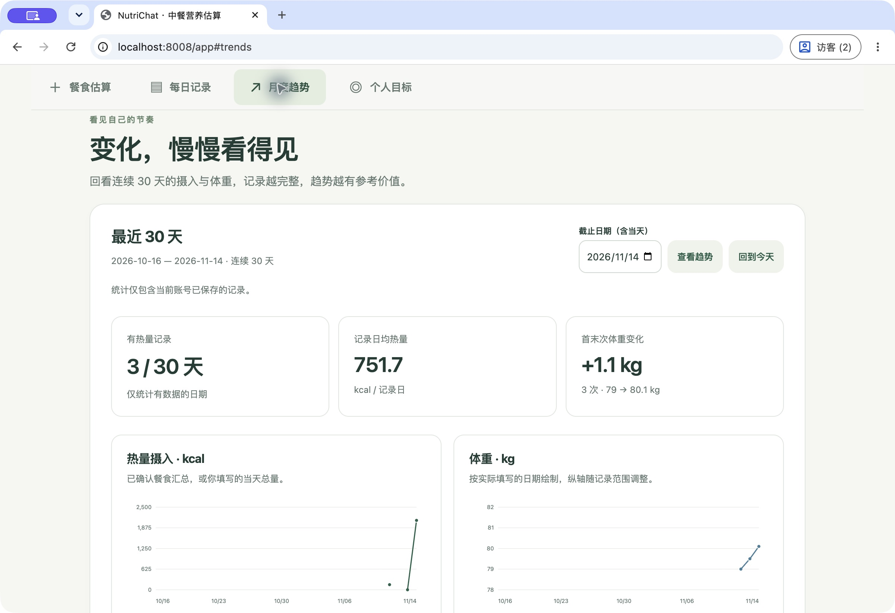
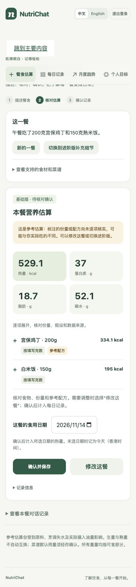

# Integrated walkthrough: review and save a meal

Use the [current setup](README.md), then register/sign in. The merged preview uses
port **8005** with a configured model; the key-free integration preview uses
**8006**. Meals, Daily diary, Trends and My goals share the same private account.
The catalogue remains 200 ingredients and 350 reference recipes.

The meal screenshots show the
[14 November recipe-usability follow-up](../docs/qa/reports/2026-11-14-recipe-usability.md).
That report records the tested build, runtime and evidence scope. The earlier
[14 November workspace pass](../docs/qa/reports/2026-11-14-fresh-review.md) retains
its own dated evidence, including the diary, trends and profile captures below.
Its isolated review used [localhost:8008/app](http://localhost:8008/app); the standard
startup instructions still use **8005** or **8006**.

## 1. Start in Meals

Describe the meal and choose Basic for a quick reference estimate or Advanced to
provide detailed weights, preparation and recipe information. After submission,
the original description becomes compact so the result and next actions are easy
to reach. Review the main totals and food weights. **Reference portion** and
**Reference recipe** badges remain visible on collapsed food rows, with a banner
explaining that these assumptions may differ from the meal. Expand a food for its
quantities, assumptions and sources.
The supported-food catalogue is searchable and shows 20 matches at a time; use
**Show 20 more** to browse further. This changes display length, not food coverage.

Advanced recipe questions show the proposed batch and its finished weight first.
Expand **Review or adjust batch quantities** to inspect or change ingredient grams
and finished weight. The acceptance checkbox remains visible outside the details;
reviewing or expanding the recipe does not accept it automatically.

Changing any quantity updates the preview and clears acceptance, so review and
accept the revised recipe before submitting. Switching language or workspace
panels preserves the draft quantities, acceptance and open details.

For a completed estimate, select **Edit this meal** to open corrections. Closing
the editor preserves an unsent reply, as do language and panel changes. An unsent
correction disables confirmation and shows a notice beside the result, including
when the editor is closed. Submit or clear a conversation correction before
confirming; for an offline replacement, submit it or restore the original full
description. For a custom ingredient recipe, select **Edit ingredients** and use
the structured editor to change the ingredients or their grams.

With Qwen/HKUST, a correction can replace the whole meal or change a portion.
Explicit complete replacements remove superseded foods; additions retain the
existing meal. Unknown foods remain unresolved without substitutions or partial
totals. For one unsupported item, enter its actual supported ingredients and
weights in the structured builder.

If a piece, bowl or cup count has no recorded conversion, Basic asks for edible
grams before showing meal totals. The hard-boiled egg record has an explicit
50 g reference for one large egg with its shell removed; other egg sizes can be
entered in grams. This adds portion metadata and leaves catalogue nutrient values
unchanged. An explicit no-oil instruction sets all cooking oils in the reference
recipe to zero, including sesame oil, while retaining the other ingredients.

In offline mode, enter `100g egg`, then select **Edit this meal** and use
**Replace full description** with `200g egg`. The legacy fixture gives 155 and
310 kcal respectively. This parser does not interpret conversational corrections.
Choose the consumption date before confirming: confirmation locks the estimate
and contributes it to that date's sum. The correction card closes; the expandable
conversation history remains available below the result.

## 2. Save a day in Daily diary

Choose a Hong Kong calendar date and review the confirmed-meal total. Weight and
exercise can be entered directly; record zero exercise when there was none, since
blank means unknown. A daily weight does not change the saved profile.

Expand **Enter a daily calorie total manually** only when overriding the meal sum.
The manual value replaces that sum, including when zero; clear it and save to
restore automatic aggregation. Expand **Check that the whole day is recorded**
to review breakfast, lunch, dinner, snacks and drinks/oils/sauces. Only the user can
confirm completeness. Save to update the diary and trends.

With an applicable profile and recorded exercise, the balance compares recorded
intake with baseline expenditure plus exercise. Its surplus/deficit is approximate;
expand the method and limitations before interpreting it. The recent-meal selector
is also here; opening a record returns to Meals for review.

## 3. Read Trends

Open the separate Trends panel and choose an end date for 30 consecutive days.
Review calorie and weight charts, recorded-day statistics and expandable daily
details, including exercise, balance and coverage. Missing dates remain gaps and
do not count as zero in averages. The charts describe recorded data, not a complete
measurement of every day.

## 4. Optionally fill in My goals

Save age, height, current weight, the formula sex coefficient, activity and a
muscle-gain or fat-loss goal. Python calculates approximate daily energy and macro
references without a model call. Review the assumptions and scope; some inputs
require professional review instead of an automatic target. A profile is optional
for meal estimation.

If another page updates the profile, reload its latest version before saving again.
Reloading refreshes dependent saved diary/trend data and preserves unsaved diary
changes.

## 5. Navigate, switch languages and return later

Switching panels or interface language preserves unsaved form values, recipe
entries and the current meal. It does not save them or submit a new estimate.
Keyboard users can move between panel tabs with arrow keys, Home and End. Save
before reloading or leaving the page; unsaved drafts are not persistent storage.

After signing in again, saved profiles, meals and daily values belong to the same
account. Another account has separate records. See the
[data upgrade policy](../docs/integration.md#data-upgrades-and-existing-records)
for older shared or ownerless data.

## Current evidence and historical screenshots

The [14 November recipe-usability follow-up](../docs/qa/reports/2026-11-14-recipe-usability.md)
records the current meal flow and the limits of its checks. Its captures are grouped
under `demo/images/2026-11-14-recipe-usability/`.

The [earlier 14 November fresh review](../docs/qa/reports/2026-11-14-fresh-review.md)
and `demo/images/2026-11-14/` remain evidence of the preceding workspace pass. Its
meal screenshots predate this follow-up; its diary, trends and profile captures
remain above with their original attribution. The earlier
[actual-ingredient workflow](images/2026-11-14/05-custom-recipe.png) and mobile
[Chinese](images/2026-11-14/06-meals-mobile-zh.png) /
[English](images/2026-11-14/07-meals-mobile-en.png) screenshots are retained as well.

The linked **2026-11-03 offline screenshots are historical**. They show
synthetic profile, persistence, tracking and mobile states before the four-panel
redesign, and do not establish current live-model acceptance.

- [Saved personal reference](images/2026-11-03/01-profile-reference-en.png)
- [Confirmed meal restored after signing in](images/2026-11-03/08-final-rebuild-persistence.png)
- [Combined diary and trends layout](images/2026-11-03/02-daily-trends-en.png)
- [Narrow-screen profile](images/2026-11-03/03-mobile-profile-zh.png)
