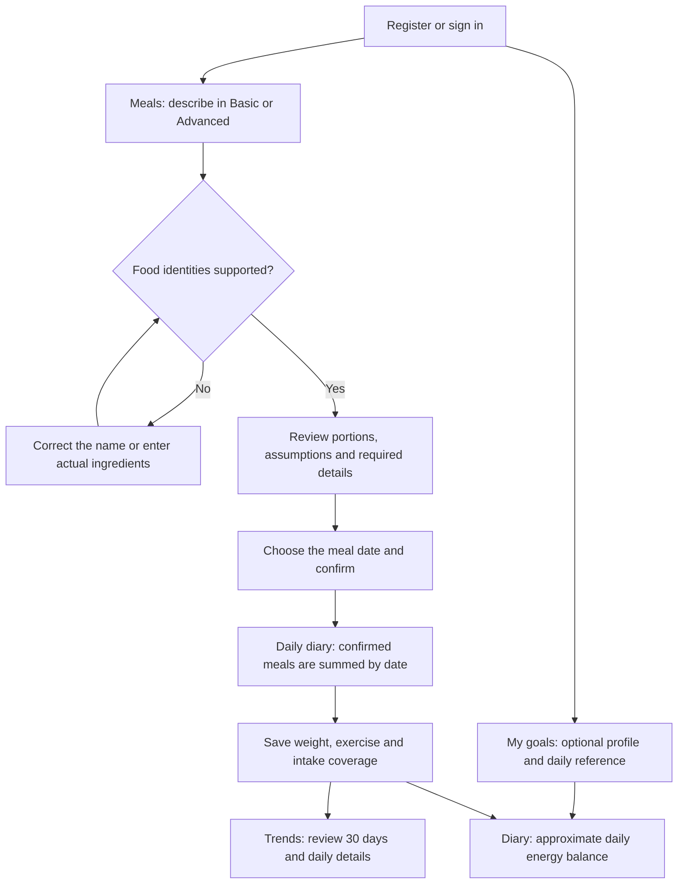
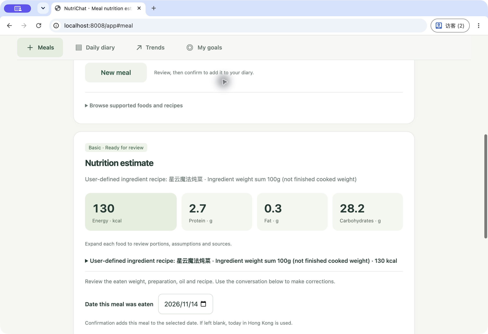
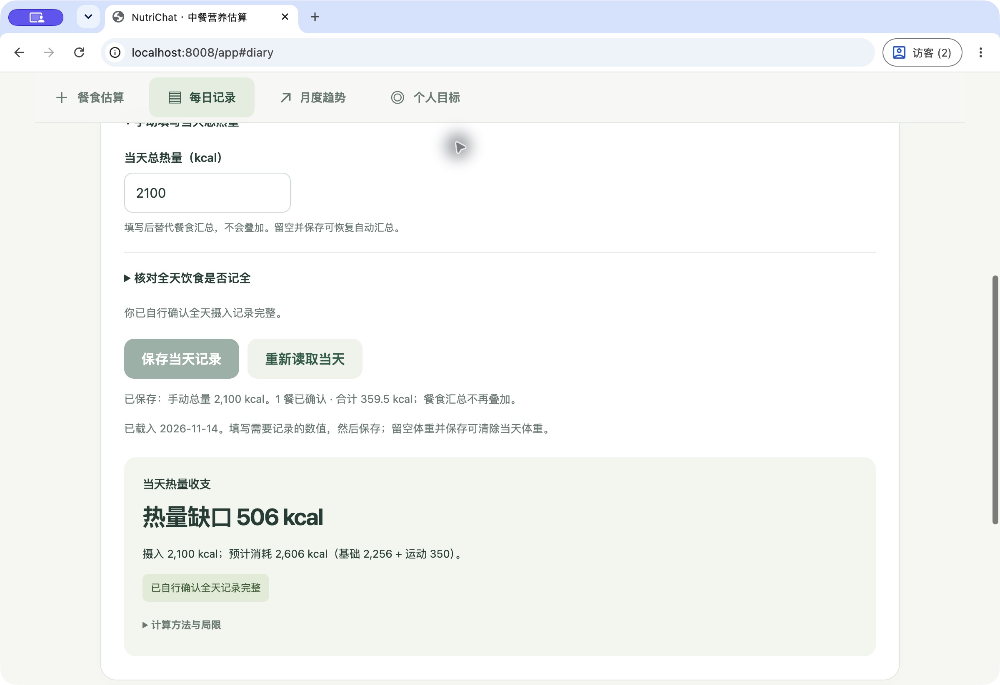
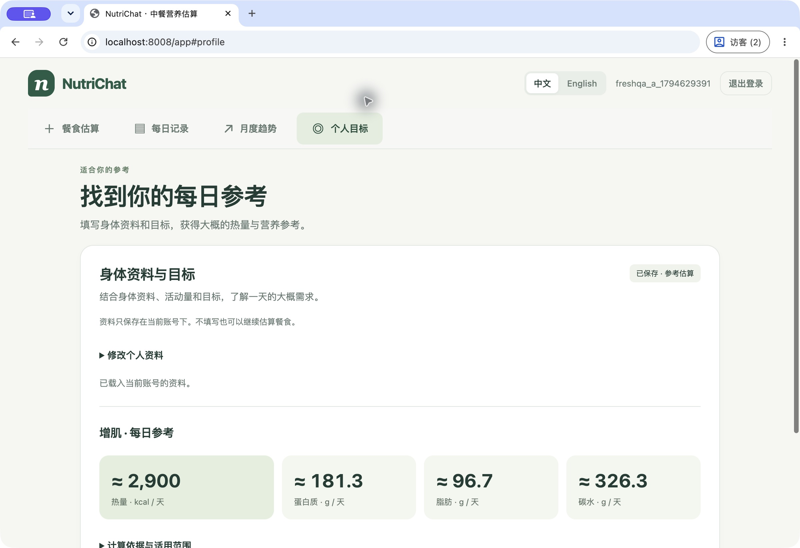
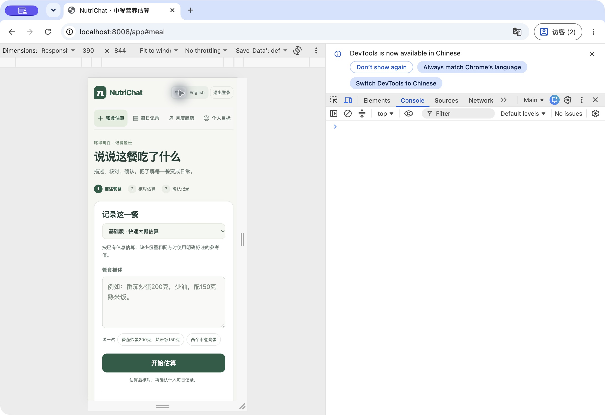
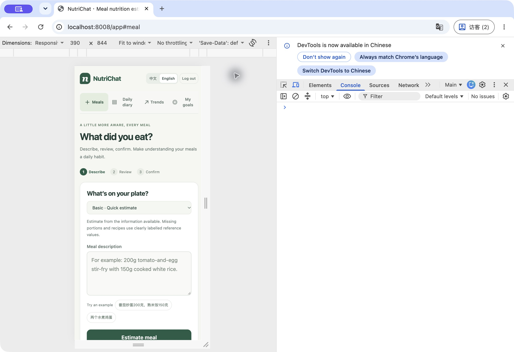

# Integrated walkthrough: four focused workspace panels

Use the [current setup](README.md), then register/sign in. The merged preview uses
port **8005** with a configured model; the key-free integration preview uses
**8006**. Meals, Daily diary, Trends and My goals share the same private account.
The catalogue remains 200 ingredients and 350 reference recipes.

The current screenshots document the isolated local review at
[localhost:8008/app](http://localhost:8008/app) on 2026-11-14. Port **8008** belongs
to that review environment; the standard startup instructions still use **8005**
or **8006**. See the [fresh review](../docs/qa/reports/2026-11-14-fresh-review.md)
for the tested build, provider and evidence scope.

## 1. Start in Meals

Describe the meal and choose Basic for a quick reference estimate or Advanced to
provide detailed weights, preparation and recipe information. Review the main
totals, then expand each food's evidence for quantities, assumptions and sources.
Questions, the actual-ingredient builder and corrections appear when relevant.
The supported-food catalogue is searchable and shows 20 matches at a time; use
**Show 20 more** to browse further. This changes display length, not food coverage.

With Qwen/HKUST, a correction can replace the whole meal or change a portion.
Explicit complete replacements remove superseded foods; additions retain the
existing meal. Unknown foods remain unresolved without substitutions or partial
totals. For one unsupported item, enter its actual supported ingredients and
weights in the structured builder.

In offline mode, enter `100g egg`, then use **Replace full description** with
`200g egg`. The legacy fixture gives 155 and 310 kcal respectively. This parser
does not interpret conversational corrections. Choose the consumption date before
confirming: confirmation locks the estimate and contributes it to that date's sum.

## 2. Save a day in Daily diary

Choose a Hong Kong calendar date and review the confirmed-meal total. Weight and
exercise can be entered directly; record zero exercise when there was none, since
blank means unknown. A daily weight does not change the saved profile.

Expand **Enter a daily calorie total manually** only when overriding the meal sum.
The manual value replaces that sum, including when zero; clear it and save to
restore automatic aggregation. Expand **Check that the whole day is recorded**
to review breakfast, lunch, dinner, snacks and drinks/oils/sauces. Only the user can
confirm completeness. Save to update the diary and trends.

With an applicable profile and recorded exercise, the balance compares recorded
intake with baseline expenditure plus exercise. Its surplus/deficit is approximate;
expand the method and limitations before interpreting it. The recent-meal selector
is also here; opening a record returns to Meals for review.

## 3. Read Trends

Open the separate Trends panel and choose an end date for 30 consecutive days.
Review calorie and weight charts, recorded-day statistics and expandable daily
details, including exercise, balance and coverage. Missing dates remain gaps and
do not count as zero in averages. The charts describe recorded data, not a complete
measurement of every day.

## 4. Optionally fill in My goals

Save age, height, current weight, the formula sex coefficient, activity and a
muscle-gain or fat-loss goal. Python calculates approximate daily energy and macro
references without a model call. Review the assumptions and scope; some inputs
require professional review instead of an automatic target. A profile is optional
for meal estimation.

If another page updates the profile, reload its latest version before saving again.
Reloading refreshes dependent saved diary/trend data and preserves unsaved diary
changes.

## 5. Navigate, switch languages and return later

Switching panels or interface language preserves unsaved form values, recipe
entries and the current meal. It does not save them or submit a new estimate.
Keyboard users can move between panel tabs with arrow keys, Home and End. Save
before reloading or leaving the page; unsaved drafts are not persistent storage.

After signing in again, saved profiles, meals and daily values belong to the same
account. Another account has separate records. See the
[data upgrade policy](../docs/integration.md#data-upgrades-and-existing-records)
for older shared or ownerless data.

## Current evidence and historical screenshots

The [14 November fresh review](../docs/qa/reports/2026-11-14-fresh-review.md) records
the tested build, current screenshots and the limits of browser, API and provider
checks. Current captures are grouped under `demo/images/2026-11-14/`; use that
report's image index rather than treating older pictures as the current layout.

The linked **2026-11-03 offline screenshots are historical**. They show
synthetic profile, persistence, tracking and mobile states before the four-panel
redesign, and do not establish current live-model acceptance.

- [Saved personal reference](images/2026-11-03/01-profile-reference-en.png)
- [Confirmed meal restored after signing in](images/2026-11-03/08-final-rebuild-persistence.png)
- [Combined diary and trends layout](images/2026-11-03/02-daily-trends-en.png)
- [Narrow-screen profile](images/2026-11-03/03-mobile-profile-zh.png)
