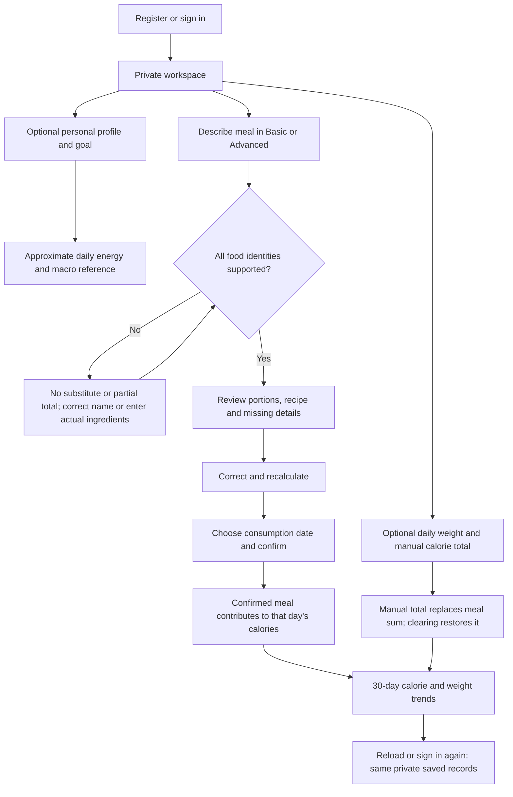
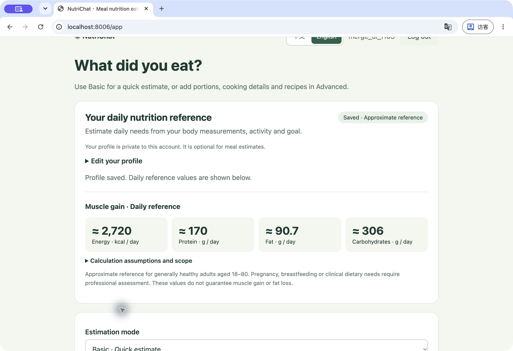
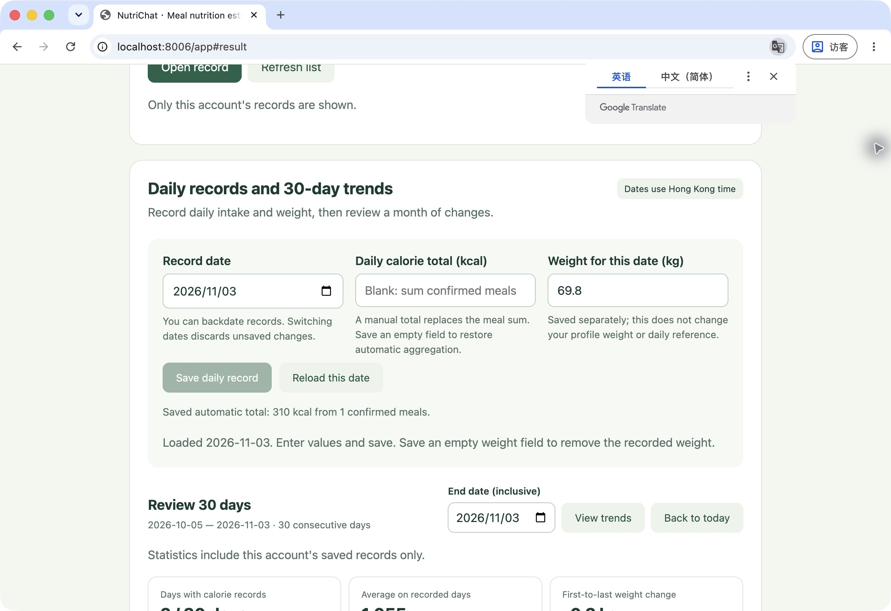
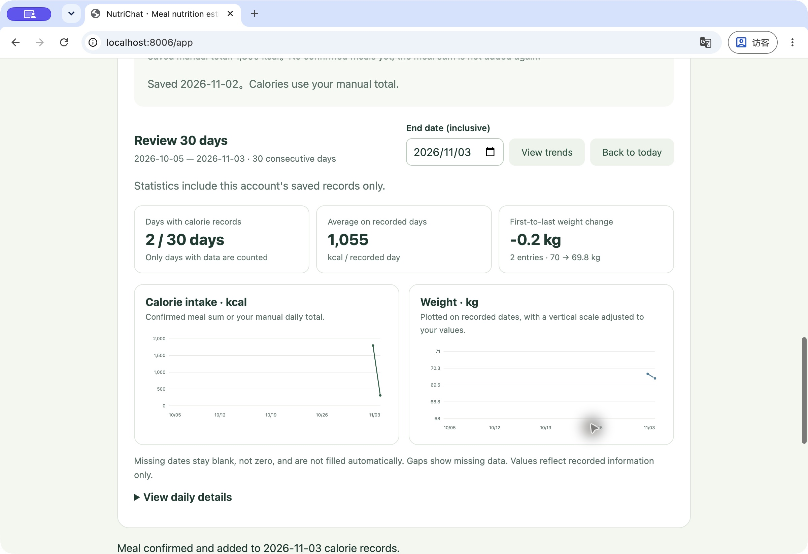
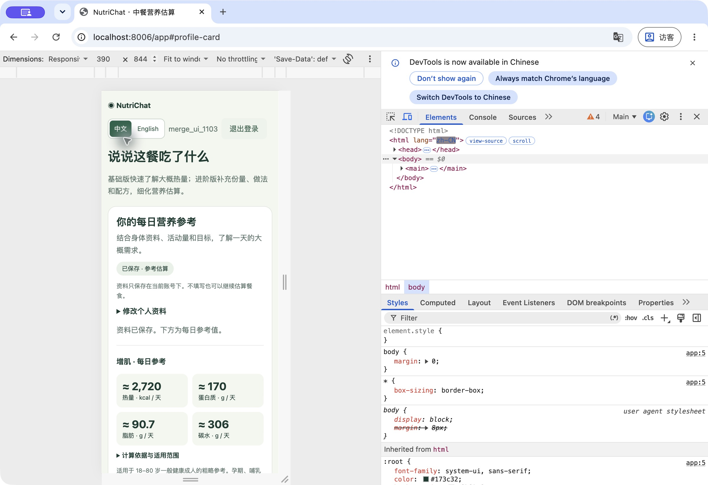

# Integrated walkthrough: accounts, meals and daily trends

Use the [current setup](README.md), then register/sign in. The merged preview
uses port **8005** with a configured model; the key-free integration preview uses
**8006**. Screenshots below show synthetic data in the offline preview on
2026-11-03, not a claim about live model recognition. All original meal-estimation
features remain available with Qwen/HKUST and the unchanged 550-record catalogue.

## 1. Fill in a personal profile

Open **Personal daily reference**. Enter age, height, weight, the formula sex
coefficient, activity and a muscle-gain or fat-loss goal; save. The app calculates
an approximate reference without calling a language model. Profile completion is
optional for meal estimation. Review the assumptions below the result.

The illustrated synthetic profile is age 25, 175 cm, 70 kg, male coefficient,
moderate activity and muscle gain. It produces 2,720 kcal in this version; these
are example inputs, not a recommendation for every user.

## 2. Review, correct and confirm a dated meal

With Qwen/HKUST, follow the [Chinese meal screenshots](SCREENSHOT_GUIDE.md) for
Basic/Advanced, clarification and the ingredient builder. Unknown foods must
remain unresolved until corrected or explicitly described with supported ingredients.

In offline mode, enter `100g egg`, then use **Replace meal description** with
`200g egg`. This produces 155 → 310 kcal using the legacy fixture. Free-text
conversation is not offered by the offline parser. With any provider, choose the
meal's consumption date before confirming. Confirmation locks the estimate and
adds it to that date's automatic calorie sum.

## 3. Save daily records and read the charts

Choose a date in **Daily records**, then save a weight and/or manual daily calorie
total. A manual total **replaces** the sum of confirmed meals, so meals are not
counted twice. Clear that total to return to automatic aggregation. Editing a
daily weight does not silently change the saved profile or its daily reference.

Select a trend end date to view 30 consecutive days. Empty days stay blank and are
excluded from the calorie average. The example has 1,800 and 310 kcal on two
recorded days, giving a 1,055 kcal average; 70 → 69.8 kg gives a −0.2 kg change.
These two points demonstrate the chart; they do not imply a measured month of use.

## 4. Switch languages and check private persistence

**中文 / English** changes interface labels without recalculating meals or losing
unsaved fields. The layout also supports a narrow phone viewport.

Sign out and sign back in: the saved profile, confirmed meal, daily values and
trends should return. Another account starts with its own empty history. The
server rejects access to another user's record even if its URL is known.

The [integration verification](../docs/evidence/integration-verification.md)
records automated, database, browser and live-provider checks separately. The
old shared-password login does not become a new personal account automatically;
see [data upgrade policy](../docs/integration.md#data-upgrades-and-existing-records).
