# NutriChat: screenshot guide for the TA

This guide shows the **Chinese meal workflow on the `nutrichat` branch**. After
the operator completes the [Qwen setup](README.md#2-main-product-demo-chinese-meals),
open **http://localhost:8003/app** directly. **No account registration or login is
required.** The model key is configured on the server, not entered by the user.
The scope of this guide is the meal-estimation workflow on `nutrichat`.

The current interface also has **中文 / English** buttons in its header. Select
**中文** to match these screenshots, or **English** to use translated controls and
clarification forms. Switching preserves the meal and unsent form values. All screenshots below were freshly captured on **31 October 2026** from the
expanded **200-ingredient / 350-recipe** runtime. Images 01–11 were captured
on source `71a0ecd`; images 12–13 verify the final correction on `dae0b94`.
The UI and catalogue files are identical between these builds. The
[independent run report](../docs/qa/reports/2026-10-31-expanded-demo.md) records
exact build provenance, actions and limitations. Browser chrome was cropped;
the page content was not reconstructed or edited.

The first six screenshots follow one synthetic meal record through the workflow. In your
own run, compare the record ID immediately before and after reload; it must remain
the same. Your new record will have its own ID. The figures depend on the selected
foods, recipe, edible weights and accepted
assumptions. They are not guaranteed outputs for every Qwen response or measured
nutrition for an actual meal. Use the [verification record](VERIFICATION.md) for
the separately recorded checks and their limits.

**Main workflow:** describe → review Basic estimate → add Advanced details →
correct the portion → review the recalculated estimate → confirm and reload.

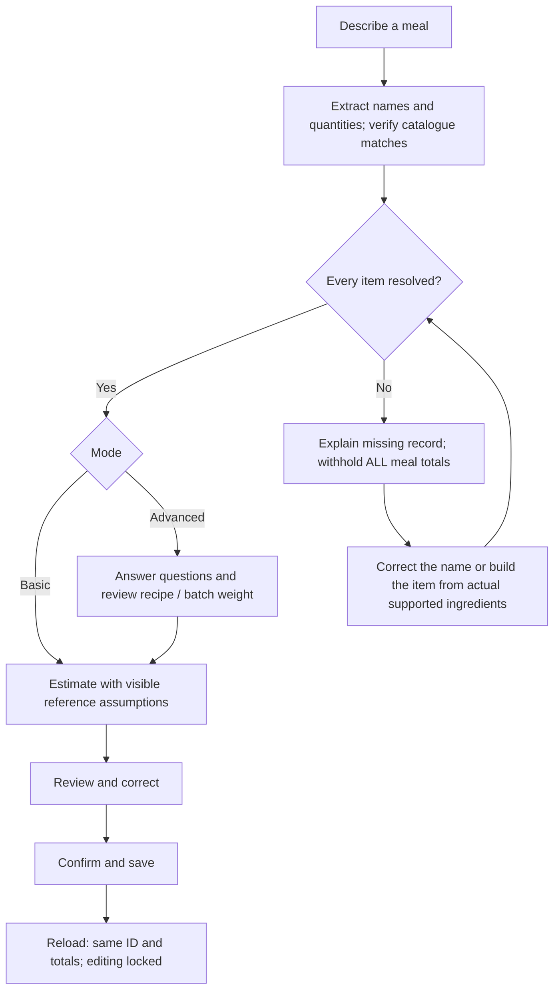

The six main screenshots use one record,
`80afe1a8-a493-44b7-a096-4234d78547f0`. It progressed from revision 1 in Basic
to revision 6 after confirmation. Your record ID will differ.

## 1. Describe a Chinese meal in Basic mode

Keep **基础版 · 快速大概估算** (Basic: quick approximate estimate) selected.
In **餐食描述** (Meal description), enter:

```text
一份番茄炒蛋，两个水煮鸡蛋
```

Meaning: “One serving of tomato and scrambled eggs, and two boiled eggs.” Click
**开始估算** (Estimate). If a previous record is displayed, first click
**新的一餐** (New meal).

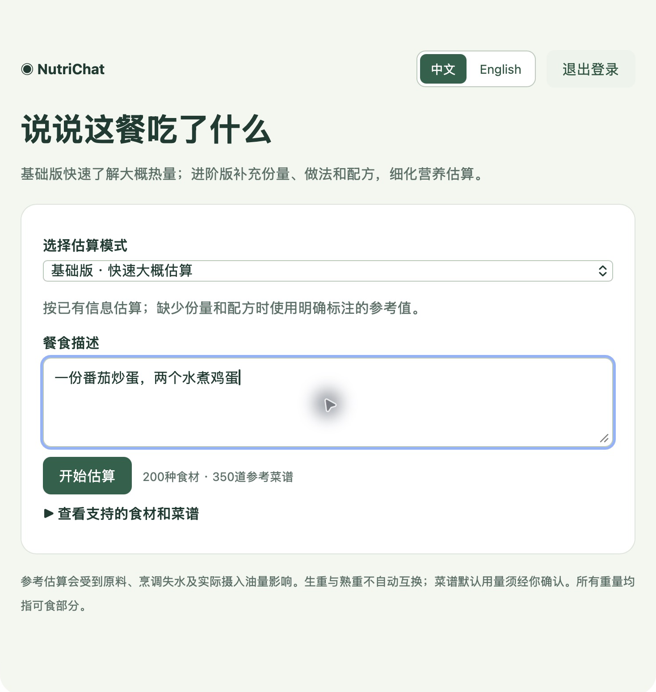

**Check:** the page shows **200 ingredients and 350 reference recipes**. This is
the Qwen product workflow, not the separate six-food offline engineering fixture.
The header's **退出登录** (Log out) button belongs to the optional public gateway;
there is no need to use it in this directly accessible local application.

## 2. Review the Basic estimate and its assumptions

Wait for **待核对确认** (Awaiting review and confirmation). Read the four cards
and the assumptions below them before accepting the result.

In the illustrated run, the app interpreted the meal as **200 g of cooked
tomato-and-egg dish plus 100 g of edible boiled eggs**, using reference serving
weights. The result was:

| Calories | Protein | Fat | Carbohydrates |
| ---: | ---: | ---: | ---: |
| 365.2 kcal | 23.3 g | 25.5 g | 10 g |

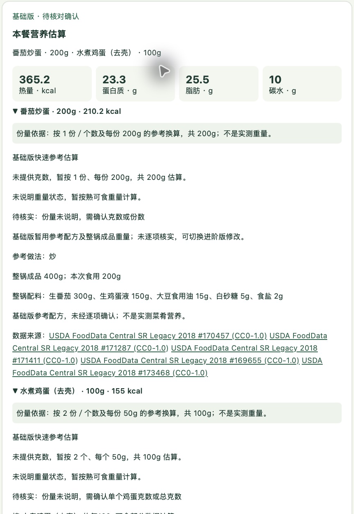

**Check:** the assumed weights and recipe are visible, not presented as quantities
the user measured. The dish details identify the whole-batch recipe and data
sources. Basic mode gives a quick estimate from limited information; it does not
prove that the reference portion matches the real meal.

For this walkthrough, **do not confirm yet**. Click
**切换到进阶版补充细节** (Switch to Advanced and add details).

## 3. Answer the Advanced questions

The app asks about information not yet supplied or confirmed. Enter **200 g** for
the cooked dish and **100 g** for the edible boiled eggs, excluding their shells.
Select the matching cooked-weight/preparation options when asked. Review any
uncertainty confirmation before checking it.

For the tomato-and-egg recipe, the illustrated run retained these **whole-batch**
reference values:

| Field | Value used in this example |
| --- | ---: |
| Raw tomato | 300 g |
| Raw whole egg | 150 g |
| Cooking oil | 15 g |
| Sugar | 5 g |
| Salt | 2 g |
| Finished whole-batch weight | 400 g |

The **200 g eaten portion** is separate from the **400 g finished batch**. The
15 g oil value is for the whole batch, not additional oil for the eaten portion.
Edit these fields when they do not match the meal being estimated.

Tick **我接受以上配方和成品重量作为本次估算依据** (Accept this recipe and finished
batch weight as the basis of this estimate), then click **提交回答** (Submit
answers). Submit any remaining requested answers until the result is ready.

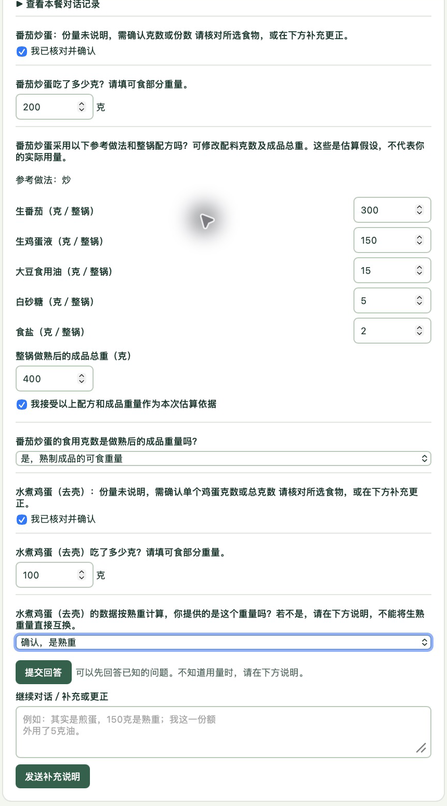

**Check:** unresolved required questions leave nutrient totals empty. The app
must not silently treat Basic defaults as facts supplied by the user. The exact
questions and their order may vary with the extracted information.

## 4. Correct the eaten portion in conversation

Before confirming, use **继续对话／补充或更正** (Continue the conversation / add or
correct details). Enter:

```text
番茄炒蛋实际吃了150克熟重，水煮鸡蛋可食部分还是100克。
```

Meaning: “I actually ate 150 g cooked tomato and scrambled eggs; the edible
boiled-egg portion is still 100 g.” Click **发送补充说明** (Send the additional
information).

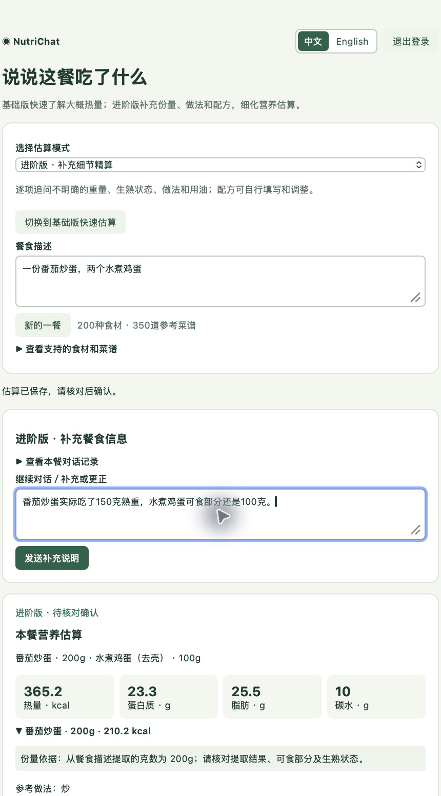

**Check:** the correction changes the dish portion while keeping the boiled eggs
at 100 g. Qwen reinterprets the conversation, so the app can ask for recipe
approval again. Review and accept the same reference batch only if that is what
you intend to use; answer any remaining questions before proceeding.

## 5. Review the corrected estimate

Read **本餐营养估算** (Nutrition estimate for this meal) again. In the illustrated
run, the corrected interpretation was **150 g of cooked tomato-and-egg dish plus
100 g of edible boiled eggs**, with the same accepted batch recipe:

| Calories | Protein | Fat | Carbohydrates |
| ---: | ---: | ---: | ---: |
| 312.7 kcal | 20.6 g | 21.8 g | 7.8 g |

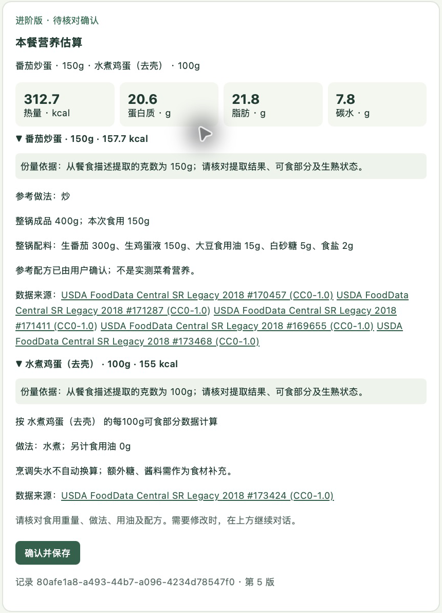

**Check:** the interpreted dish portion is now 150 g; the result and recipe
details reflect that change. The original description can remain visible at the
top because the correction is part of the saved conversation. Read the current
interpretation and details, not only the original text box.

These numbers illustrate this particular recipe and interpretation. If a new run
differs, compare food mappings, quantities, assumptions and accepted recipe values
before deciding whether there is an error. Then click **确认并保存** (Confirm
and save).

## 6. Reload and verify the confirmed record

Refresh the browser after confirmation. Verify that **已确认保存** (Confirmed
and saved), the same record ID, and the same final totals remain visible.

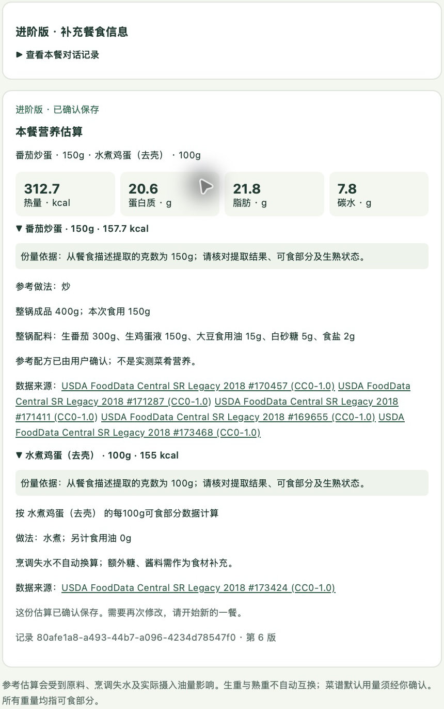

**Check:** the confirmation button, conversation correction form and mode switch
are no longer available. The page says that further changes require **新的一餐**
(New meal). Confirmation locks the reviewed record; reloading reads the saved
result rather than creating another estimate.

The browser remembers the last viewed meal ID. This branch has no independent
accounts or personal history list. A reviewer can copy the displayed ID and
inspect `GET /analyses/{id}` in http://localhost:8003/docs.

## Optional: use the English interface

Select **English** in the header, or **中文** to switch back. Controls and
clarification forms change language while meal facts and unsent values remain.
The browser remembers the language. Existing catalogue translations remain;
**new Chinese-first entries currently retain Chinese names and method notes**.
User descriptions and model free text also retain their original wording.
Switching language does not change the model's recognition behavior.

The separate example below used `150克豉油鸡，85克可乐鸡翅，125克蒜蓉空心菜。`
and returned all three intended dishes: 629.9 kcal, 48.1 g protein, 41.1 g fat
and 17.4 g carbohydrate. It was saved for review, not confirmed.

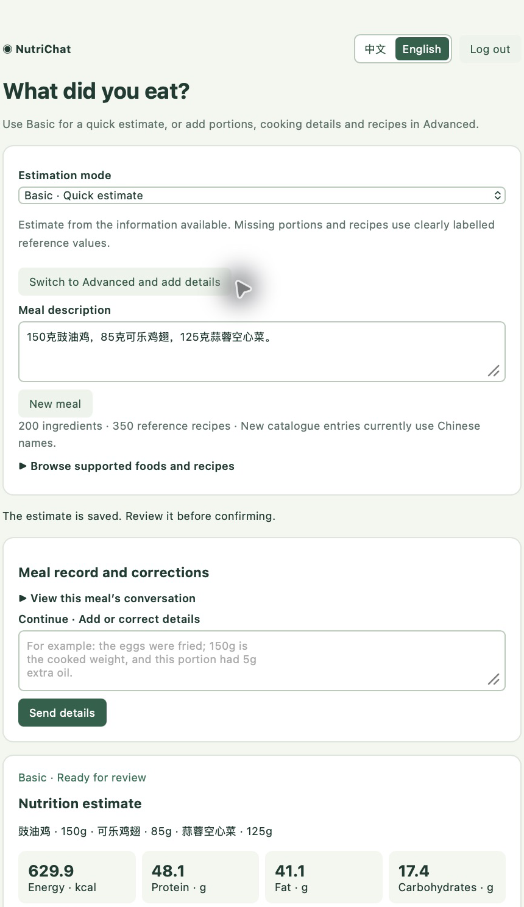

See the [language-switch verification](../docs/evidence/ui-language-verification.md)
and [latest browser report](../docs/qa/reports/2026-10-31-expanded-demo.md) for
versioned evidence and remaining recognition limitations.

## Optional: handle a food with no corresponding record

Start a new Basic meal and enter the deliberately fictional example:

```text
100克熟白米饭，200克月球紫晶兽肉。
```

The app must state that the second item has no corresponding food record.
**All meal totals remain absent**, including the known rice. It must not replace
the unknown item with another dish or offer a partial rice-only meal total.

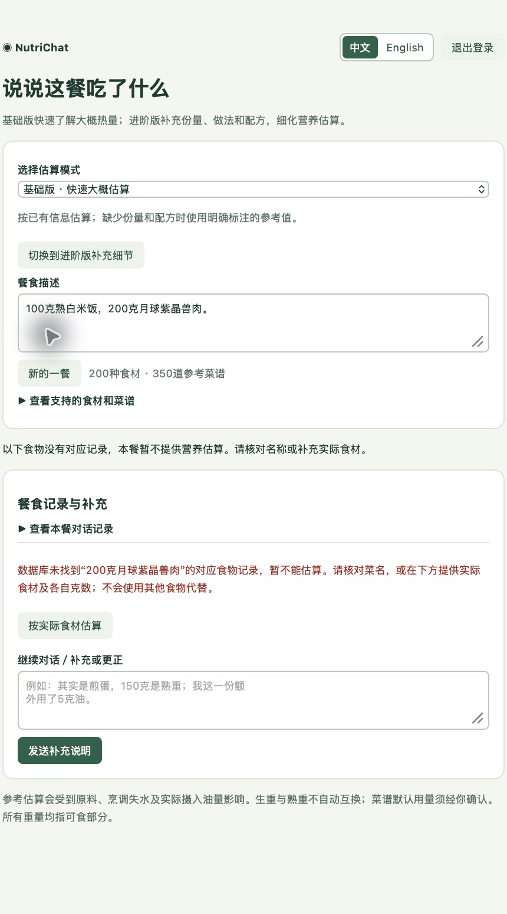

Check the original name first. If it was a typo, correct it in the conversation.
If you know the actual ingredients, click **按实际食材估算** (Build from actual
ingredients) beneath that item. This form replaces only the selected item;
other meal items remain. A fictional food has no real recipe: the following
synthetic recovery explicitly replaces it with a user-defined chicken recipe.
The application does not infer this substitution.

1. Set the name to **自定义鸡肉配方** (custom chicken recipe).
2. Select **整锅配料，再填写本次吃下多少** (whole batch, then portion eaten).
3. Search for each ingredient, then **explicitly select its record and state**.
   Search text alone is not a selection. Use **添加食材** (Add ingredient) for
   the additional rows.

| Selected ingredient | Whole-batch amount | Required weight basis |
| --- | ---: | --- |
| 生去皮鸡胸肉 — raw skinless chicken breast | 300 g | Raw edible weight before cooking |
| 大豆食用油 — soybean cooking oil | 10 g | Edible net weight |
| 普通酱油 — regular soy sauce | 20 g | Edible net weight |

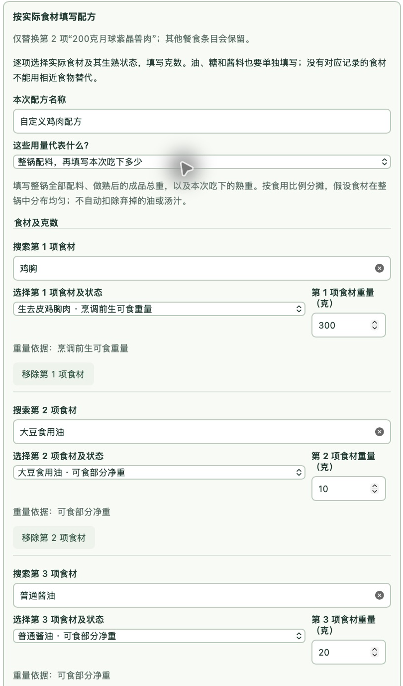

4. Enter **600 g** finished whole-batch weight and **150 g** eaten cooked weight.
   These illustrative values are separate from the ingredient weight sum. Include
   all actual ingredients, oil and sauces for your own meal.
5. Review the quantities and states, tick the acceptance checkbox, and click
   **按这些食材计算** (Calculate from these ingredients).

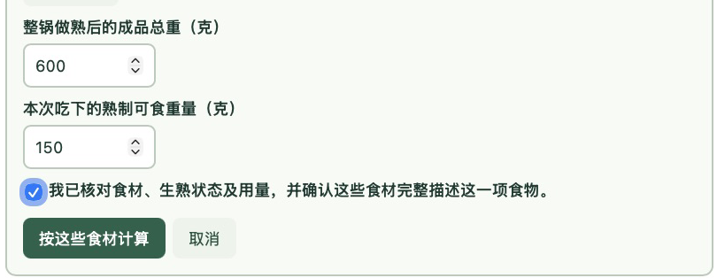

The illustrated calculation allocates **150 / 600 = 25%** of the recipe's
nutrients. The chicken recipe contributes **114.8 kcal**; the retained 100 g rice
contributes **130 kcal**. The whole meal is **244.8 kcal**, 20 g protein,
4.8 g fat and 28.4 g carbohydrate. The result labels it a **user-defined
ingredient recipe**, not measured nutrition for a database dish.

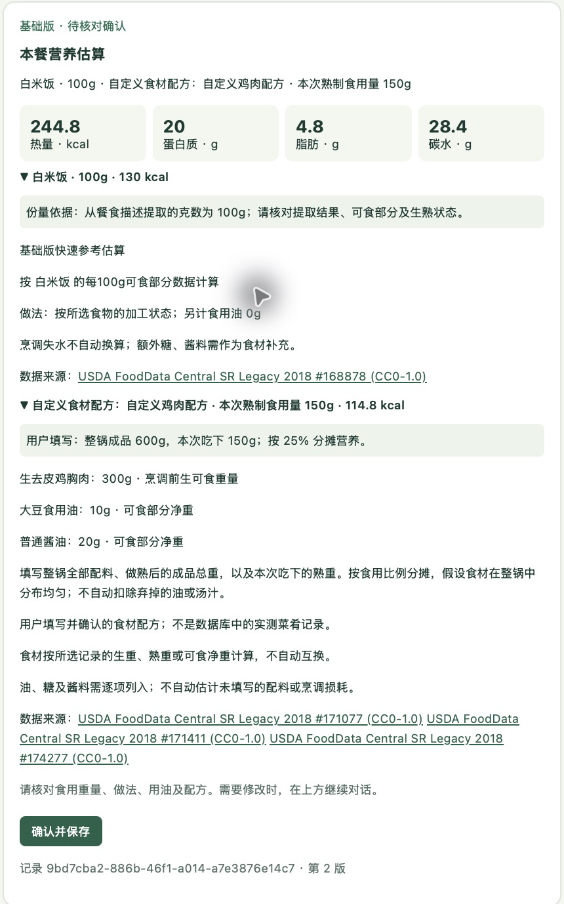

Before confirming, use **编辑食材配方** (Edit ingredient recipe) to change this
recipe. Free-text correction is replaced by structured-editor guidance while a
custom recipe exists, to preserve its selected ingredients. Review, confirm and
reload as in step 6. The app assumes the batch is evenly mixed and does not
remove discarded oil, broth or cooking losses automatically. If an ingredient
itself has no record, do not select a different ingredient as a substitute.

The custom record was then confirmed and reloaded on the final build. The same
record `9bd7cba2-886b-46f1-a014-a7e3876e14c7` remained at **244.8 kcal**, revision
3, with editing controls removed.

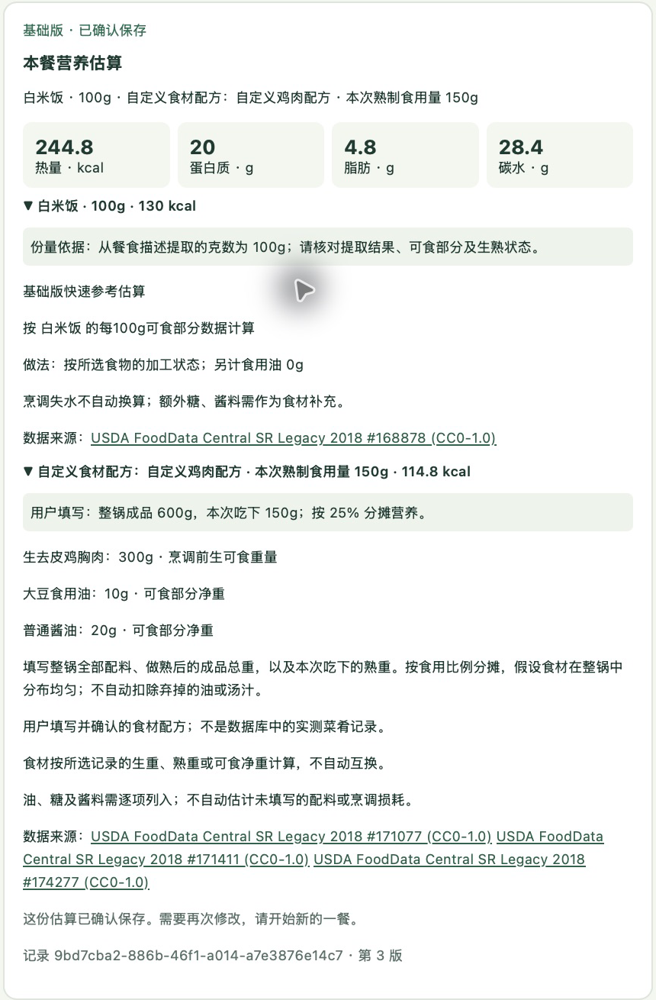

## Additional catalogue check on the final build

This exact Basic input was checked after fixing a false rejection of the
parenthetical phrase `（已去骨）` (bones already removed):

```text
豉油鸡200克熟重、可乐鸡翅75克熟重（已去骨）、蒜蓉空心菜150克熟重。
```

The final run recognized all three intended dishes and weights, returning
743.8 kcal, 56.9 g protein, 48.5 g fat and 20.4 g carbohydrate. The reference
recipes remain assumptions; expand each dish row to inspect them. This record
was saved for review, not confirmed. The earlier failed run is preserved in the
[QA report](../docs/qa/reports/2026-10-31-expanded-demo.md).

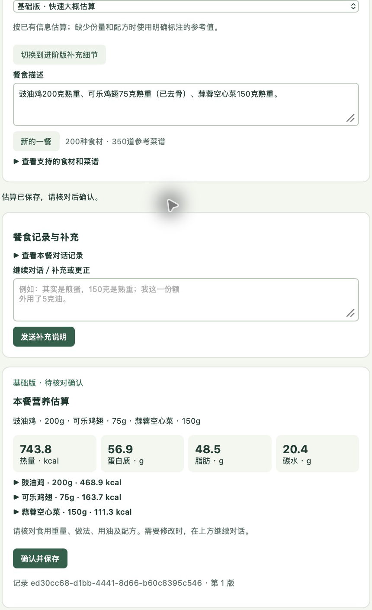

## What to inspect beyond the pictures

- Follow the [full walkthrough](WALKTHROUGH.md) for the English control guide,
  internal responsibilities, state transitions and limitations.
- Run the [separate offline integration check](README.md#3-optional-offline-engineering-check)
  to inspect actual API responses, PostgreSQL rows, worker logs, correction,
  confirmation and locked edits without a Qwen key.
- Treat screenshots as illustrations of an observed run. They do not replace
  running the application, and they do not establish that every live model call
  succeeds. Record provider failures separately rather than substituting an
  offline result for a Chinese estimate.
