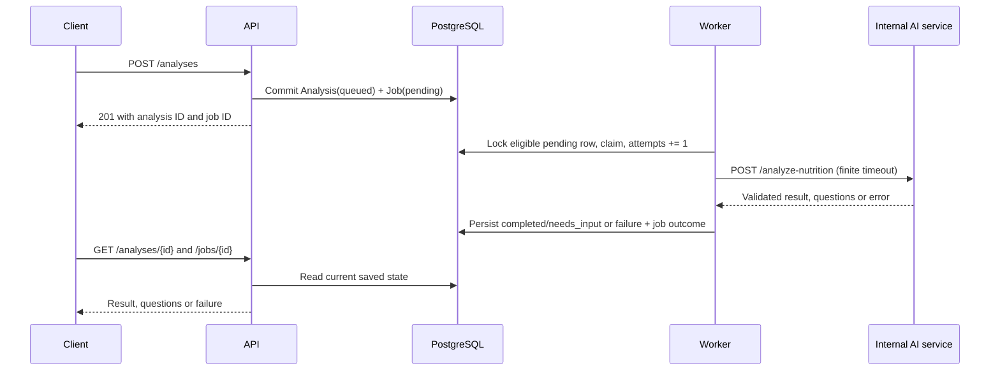

# NutriChat architecture

Implementation baseline: `nutrichat` at
`1d17a66ffa445a5dc6a4d699e408c6772929ea79`. `nutrichat` is the default integrated
branch; `test` remains available for development. Remote `main` branches were
removed after preservation under archive tags. The refreshed final package uses
`w13-final`; its earlier checkpoint is preserved at `archive-w13-final-6b87aef`,
resolving to `6b87aef772f7cfde139a383c866e5576ea955cb3`. See the exact release
boundaries in [integration](integration.md). Publishing the release does not
resubmit Canvas or establish a deployment of the current code to ECS.

Catalogue `2026-11-24.2` contains 202 USDA ingredient records and 384
project-authored reference recipes. Sixteen existing recipe identities also carry
separate CFS prepared-food references. Source-vector calculations and ingredient
calculations remain distinct. The 23 November expansion added 34 recipes and
preserved the previous formulas at that step; the later
[white-cut chicken correction](white-chicken-reference.md) changed that dish's
reference and added two cooked-chicken ingredient records. The current catalogue
must not be described as preserving every original formulation.
Meishichina supplies dish-name/style evidence, while editable recipe quantities
and yields are project assumptions. See [home-recipe provenance](home-recipe-expansion.md)
and [CFS source boundaries](cfs-prepared-food-references.md). Data and validation
updates do not train model weights. Account/profile/tracking migrations extend
the application schema separately.

## Services and data flow

```text
Browser -> [optional HTTPS proxy] -> FastAPI API + account sessions
                                                       | PostgreSQL
                                                       | analyses + jobs
                                                     Worker
                                                       | HTTP
                                                Internal AI service
                                                  |           |
                                             Qwen/HKUST  Python meal engine
                                                  |           |
                                              extraction   catalogue arithmetic
```

The diagram shows the main asynchronous meal-analysis path: the API atomically
saves an analysis and pending PostgreSQL job; a separate worker claims the job,
calls the internal AI service and persists the result or questions. The browser
polls the API and renders saved state. PostgreSQL is the source of truth;
localStorage remembers the last analysis ID per internal user ID and the browser's
interface-language preference. It does not store authoritative records, profile
measurements or session tokens.

Profile and tracking calculations are synchronous API operations without AI calls.
The optional `reference-inference` and `reference-candidates` operations are also
synchronous: the API calls the AI service directly with `httpx`, validates and
saves the response, and returns the updated analysis without creating a job.
Candidate requests with missing facts or no compatible shortlist do not call the
model. `reference-selection` only saves an unaccepted template. Acceptance through
`/ingredients` then queues the ordinary deterministic worker calculation.

- API: accounts, authorization, profiles/references, diary/trends, validation, revision/state checks, saved records, catalogue and HTML UI.
- Worker: asynchronous orchestration and job/error bookkeeping.
- AI service: Qwen/HKUST extraction, experimental Ollama, or legacy demo parsing, followed by deterministic evaluation.
- Shared meal engine: catalogue validation, questions, structured answers, assumptions and nutrient arithmetic.
- PostgreSQL: users, password hashes, hashed sessions, private profiles/daily records, account-owned analyses/cases, conversations, drafts, questions, evidence and jobs.

## Personal profile calculation

The authenticated API stores one current profile per user. The synchronous
`mifflin-evidence-2026-v2` calculator derives approximate energy and macro references
without calling the worker, AI service or any model. It uses age, height, weight,
formula sex coefficient, activity, goal, and explicit strength-training and adult
scope answers. Profile input never joins meal-extraction or reference prompts.

Valid inputs are saved even when references are withheld. Missing scope/training
answers, a professional-guidance scope, muscle gain without strength training,
BMI below 18.5 or at least 40, low proposed energy, energy below estimated resting
expenditure, or an out-of-scope macro distribution return `needs_review` with all
four target values null. Daily balance is also withheld for an ineligible profile;
ordinary meals and diary recording remain available. These are product eligibility
rules, not a clinical assessment. See [personalization](personalization.md) for
formulas, source limits and the exact guard codes.

Conditional revisions prevent stale tabs from overwriting newer data. Migration
0007 creates `user_profiles`; `20261121_0011` adds nullable `strength_training`
and `reference_scope` without defaults or consent backfills. Historical profiles
therefore need explicit answers before targets return. Omitted new fields preserve
existing answers on update; explicit null clears them. Only current inputs are
stored, with references computed on read; historical target snapshots are absent.

## Daily records and trends

Migration 0008 adds one optional daily record per user/date and a consumed date on
analyses. Daily records contain weight, a nullable manual calorie override and an
optimistic revision. The API computes automatic calorie totals from that user's
confirmed meals and combines them with the daily records for a 30-day window.
Manual totals replace meal sums, and absent data remains null. Historical results
use saved meal estimates, not a recalculation against today's catalogue. Migration
0009 adds nullable exercise calories, and 0010 adds the five-category intake
coverage checklist. A blank exercise value is unknown; zero explicitly records
no exercise. Coverage is self-reported and does not prove complete intake.

When intake, an applicable profile and exercise are available, the API derives an
approximate energy balance using `resting_kcal × 1.2 + exercise_calories` as
expenditure. The fixed baseline avoids counting the profile activity factor and
logged exercise twice. A surplus or deficit has a nonnegative magnitude; absent
prerequisites withhold the balance. Changing the current profile can recalculate
displayed balances for past dates; there are no historical profile snapshots.

The browser draws two SVG charts and a corresponding data table. Tracking does not
call the worker or Qwen, change the personal profile, or store measurements in
localStorage. Charts do not project the current nutrition target onto past dates;
the separately derived balance uses the current applicable profile. See the
[tracking contract and migration policy](tracking.md).

## Four workspace panels

The browser presents **Meals**, **Daily diary**, **Trends** and **My goals**. Meals
contains input, results, clarification, correction and confirmation; Diary contains
dated intake, weight, exercise, coverage and recent meals; Trends contains the
30-day charts/table; My goals holds the optional profile and references. Panel and
language changes preserve unsaved form values without submitting them. Draft
values are not promised to survive a page reload.

After submission, the result takes priority over the compact original description.
Reference badges and the uncertainty notice remain visible while source details
are collapsed. Recipe questions show a batch preview before optional quantity
controls. Explicit recipe acceptance is required; quantity or finished-weight
edits clear it. Unsubmitted meal corrections block confirmation of the old result,
even when the correction editor is closed. The catalogue renders 20 search hits at
a time with a control to reveal further results; this does not reduce coverage.

## Chinese and English interface

The header's **中文 / English** buttons change display language locally. The API
serves `/app` and an explicit allowlist of four JavaScript files under
`/app-assets/`: `catalogue-en.js`, `i18n.js`, `account-i18n.js` and `app.js`. These files are packaged
with the Python application, loaded in that order and served with `no-cache` so
the browser revalidates after an update. Authenticated HTML and private API responses use `no-store`. No frontend build service is required.

`i18n.js` translates controls, status messages, structured questions and evidence.
The English display catalogue covers all 586 records and all 384 recipe methods,
including the 162 previously untranslated entries. Catalogue search checks Chinese
and English display names. Reviewed English names are also exact matching aliases;
translation alone does not authorize other English synonyms. User descriptions and free-form model notes retain their
original language. Display language is separate from matching: recognition is
restricted to recorded names and explicitly reviewed aliases, regardless of the
selected interface language.

A language change rerenders presentation while preserving unsent meal/reply text,
selected mode, question answers, editable recipe quantities/yield and acceptance.
It does not send a model request, create a job or modify the saved record's ID,
revision, state or nutrient values. Language selection remains usable when browser
storage is unavailable, but the preference then cannot persist across reloads.
See [the language verification record](evidence/ui-language-verification.md).

## Model providers and their role

Qwen runs in Alibaba Cloud Model Studio, not on ECS. It interprets meal descriptions, names, preparation, quantities and corrections and maps them to supported catalogue IDs. Chinese meals are the primary product workflow; English descriptions also use this same extraction path. Interface language does not alter its prompt or improve food matching. The adapter requests structured JSON, with `enable_thinking=false`, temperature 0 and a configurable model (default `qwen-plus`). Disabling deep-thinking mode does not remove language inference or guarantee correctness.

HKUST GenAI uses the same bounded extraction and deterministic identity checks with
an OpenAI-compatible adapter. `LLM_PROVIDER` overrides `NUTRITION_PROVIDER` when
set; `heuristic` maps to the offline `demo` provider. The Ollama adapter is retained
for experiments, but earlier tested models did not meet full workflow acceptance.
Provider-specific credentials are server-side and are not exposed to the browser.
Offline mode accepts six English gram-based foods; free-text corrections return
422 and require an explicit full-description PATCH instead.

The model does not supply authoritative calorie/macronutrient values, approve recipes, or train on project updates. Python validates the extracted facts and calculates from the versioned catalogue. Structured question answers bypass another model call; natural-language replies use the bounded conversation as context. Updating aliases, food data or prompts changes application behavior without retraining model weights.

The prompt receives a bounded shortlist instead of the entire growing catalogue.
`catalogue_candidates` selects up to 60 records using recorded name/alias spans
from the user's text and adds recipe ingredient context, with at most 120 records
in total. Retrieval only supplies interpretation context: substring candidates do
not authorize a match, and the separate identity guard below still decides whether
an extracted food corresponds to a complete supported user mention. Missing names
are not filled by a fuzzy nearest-dish search.

HKUST uses the gateway's supported JSON-object format with the extraction schema
included in the prompt; native `json_schema` requests were rejected by the tested
gateway. The adapter can normalize exact Chinese preparation labels to their
existing enum equivalents, but does not infer weight states, food identities or
nutrients from invalid fields. Strict response validation still fails closed.

## Food identity boundary

The matching follow-up adds a deterministic identity check between model extraction
and nutrient calculation. The backend resolves each complete user-provided food
mention to a unique recorded name or reviewed alias. This exact lookup determines
the ID even if the model proposes a different one; it never selects the nearest
food. An existing catalogue ID alone is not evidence of a correct match.
Explicit gram amounts are recovered from the adjacent complete recorded food
mention in comma-separated, space-separated or unpunctuated compact input. This
fallback preserves user-supplied quantities when model extraction omits them; it
does not infer a weight or accept an unsupported name. The reviewed fish names
`水煮鱼`, `水煮魚` and `水煮魚片` share existing `dish_126` and its disclosed
reference formulation.
Names copied from assistant suggestions or generated catalogue labels are not
independent user evidence. Similar-looking names or ingredient substrings must
not authorize a different dish.

Known-name matching accepts reviewed adjacent edible-state annotations such as
`已去骨` and `已去壳`. This narrow boundary rule does not authorize unknown dish
names, substitute another food or infer a gram quantity.

An unsupported or unverified match is retained as an unresolved item. The user
sees that no corresponding food record was found; no substitute dish, per-item
estimate or partial meal total is returned. The user can correct the name or use
the structured ingredient builder to select actual supported ingredients and
weights. Free-text ingredient recovery remains fallible and is not the reference
recovery route. Basic mode
may assume portions for a supported identity; it must not assume an identity for
an unsupported food. This stricter boundary can reject unlisted synonyms and is
not a guarantee that all remaining model facts are correct. Follow-up verification
is recorded separately from the earlier language-switch checks in
[the matching verification](evidence/food-matching-verification.md).

## Two modes and uncertainty

Basic mode applies labelled defaults to a calculation copy: reference portions, reference recipes and applicable extra-oil assumptions. The stored draft retains missing fields, so switching to advanced mode asks for details that were never supplied.

Advanced mode asks for grams, weight state, preparation and consumed oil as needed. Recipe calculations require explicit acceptance of editable ingredient quantities and finished batch yield. Unmatched foods or contradictory raw/cooked/preparation facts can require questions in either mode. Pending questions leave every nutrient total null.

Ingredient calculations sum grams multiplied by the corresponding per-100-g
nutrient data. Recipe portions scale the whole-batch nutrients by consumed cooked
edible weight divided by finished batch weight. The separate CFS prepared-food
path scales the complete source vector by cooked edible portion; it never mixes
source calories with recipe macros. Basic mode uses that source path for an
ordinary eligible match; Advanced mode offers source or ingredient calculation.
Explicit ingredient, yield or oil details use ingredients, including zero oil.
Raw or gross bone/shell weights need clarification before a prepared-food source
can be used. Actual-ingredient and similar-reference recipes always use their
accepted ingredients. See [CFS routing](cfs-prepared-food-references.md).

CFS available carbohydrate and USDA total carbohydrate by difference keep their
source definitions. Mixed-definition meals show separate labelled carbohydrate
subtotals, with the combined carbohydrate field null; energy, protein and fat
remain available and the meal can still be confirmed. Saved source versions,
basis and caveats are retained with the result. Data provenance, limits and
exceptions are detailed in [nutrition data](nutrition-data.md).

The [explicit ingredient builder](ingredient-recipes.md) can replace one unresolved
draft item with a user-accepted recipe. `POST /analyses/{id}/ingredients` enforces authenticated ownership and validates
existing ingredient IDs, states shown for review, gram bounds and consumed/batch
basis. It preserves every other draft item and queues the normal worker with the
validated draft, so the calculation service does not call the model again. Model output
cannot supply `custom_recipe`; that field is created by the structured API path.
An unresolved item elsewhere still suppresses all totals. Custom calculations
retain their ingredient/portion provenance and are labelled separately from a
catalogue dish. Free-text replies are blocked for a meal containing custom recipes
to prevent re-extraction from discarding those facts; structured edits, clarification
answers, mode changes and final confirmation retain the ordinary revision rules.

## Persistence and concurrency

Analysis states are `queued`, `needs_input`, `completed`, `failed`, `confirmed`. Jobs track `pending`, `claimed`, `completed`, `failed`. Worker-generated clarification completes its job without failing; synchronous reference clarification can occur without a job. User correction/reply/mode-switch requests check the current revision and state; confirmation locks completed records. The [API contract](api-contract.md) defines the payloads and transitions.

Alembic migrations add the analysis workflow, revision/confirmation fields (0003), JSON dialogue and evidence (0004), and mode (0005). Existing analyses receive `advanced` as their default mode. Migration 0006 adds users/sessions and nullable owners; ownerless historical
records remain preserved but inaccessible to new accounts. Migration 0007 adds
profiles; 0008 adds daily records and backfills older confirmed meal dates using
Hong Kong confirmation dates. Migrations 0009 and 0010 add exercise and intake
coverage respectively. Migration 0011 adds nullable profile scope/training answers;
the current head is `20261121_0011`. These migrations do not overwrite saved
nutrient results or food catalogue files. API startup runs migrations before the
worker starts.

## Deployment boundaries

The recommended merged preview uses `compose.integrated.yaml`, project
`nutrichat-merged-qwen`, and API loopback port 8005. It keeps AI/PostgreSQL internal
and uses a separate database volume; only AI receives private provider settings.
The separate offline demo defaults to project `nutrichat-integrated-demo` and port
8006. Project names isolate Docker resources; port changes alone do not.

Cloud Compose remains a separate deployment procedure. Optional public Compose
adds Nginx on 80/443; authentication and ownership are enforced by the API, not the
old shared-password gateway. These documents do not establish that ECS is running
the current candidate. Secrets,
certificates and backups remain external files excluded from Git. See
[the integration guide](integration.md) and [cloud deployment](cloud-deployment.md).

The API readiness probe checks PostgreSQL. AI readiness reports service availability but does not call Qwen. Structured logging and Prometheus metrics support observation; they do not constitute end-to-end model validation.

## Current limitations

Food coverage is limited to 202 ingredient records and 384 reference recipes;
this is not a general food database. Unlisted foods, names and variants need
clarification or catalogue additions instead of a substitute estimate.

Independent accounts, profile references and private diary/trends are implemented.
Password reset, Google login, account deletion and historical target snapshots are
not. Sessions use opaque tokens, stored only as hashes server-side, with an
in-process authentication rate limiter; production multi-replica operation needs
additional shared controls. Profile calculations are simplified adult references,
not measured needs or clinical prescriptions. See [accounts](accounts.md).

There is no idempotency key, automatic retry, claimed-job recovery, image
recognition, model training or measured cooking-loss model. Use one worker for
this prototype. Reference recipes and portions are assumptions, and even detailed
estimates depend on the quality of input and food mappings. Model extraction can
fail or propose a similar but incorrect food. The identity guard rejects
unverified food matches, but it does not prove that all quantities or cooking facts
are correct. Users must review interpreted foods and assumptions before confirming.

See [ADR 0001](adrs/0001-baseline-stack.md) for the starter stack,
[ADR 0002](adrs/0002-source-backed-dual-mode.md) for the nutrition design and
[ADR 0003](adrs/0003-private-tracking-and-release-boundaries.md) for account-private
tracking and release boundaries. The latest recorded application checks are
[24 November name-reference verification](evidence/name-reference-inference-verification.md):
2,670 backend and 108 frontend tests, plus 49 bounded live model calls with the
failures and limitations retained. The final three live checks were targeted, not
a rerun of the entire earlier 20-name batch; the thigh example still returned no
candidates. The [CFS pilot review](evidence/cfs-pilot20-review.md) records the
separate source-reference work. [Week 13 verification](evidence/week13-verification.md)
and the [14 November meal/browser review](qa/reports/2026-11-14-recipe-usability.md)
remain historical evidence for their own snapshots. No test or smoke rerun is
claimed by this documentation refresh.

## Worker contract and state ownership

The selected asynchronous step is meal interpretation and nutrition evaluation.
An external Qwen request has variable latency; the API validates/enqueues and returns
201 without waiting for it. The no-key demo provider exercises the same durable
worker path with deterministic input. See [the Week 6 evidence and workflow](async-workflow.md).



| Analysis / Job state | Owner | Entry condition and persisted evidence | API-visible meaning / next step |
| --- | --- | --- | --- |
| `queued` / `pending` | API | Valid input; both rows committed together; attempts 0 | Accepted, waiting for worker |
| `queued` / `claimed` | Worker | Pending job selected with `FOR UPDATE SKIP LOCKED`; claim time and attempts increment committed | Processing visible through Job; Analysis has no separate processing state |
| `completed` / `completed` | Worker | Valid result and job completion timestamp saved; combined carbohydrate may be null for mixed definitions | Ready for review; user may correct, switch mode or confirm |
| `needs_input` / `completed` | Worker | Draft/questions saved; all totals null; job completion timestamp saved | Clarification required, not a failed processing attempt |
| `failed` / `failed` | Worker | Caught exception; generic analysis error, bounded job error and completion timestamp saved | Correct/reply to enqueue a new job after resolving the cause |
| `queued` / new `pending` job | API | Revision/state checked correction, reply or mode switch; old totals cleared | New work; previous job remains historical evidence |
| `confirmed` / previous job unchanged | API | Current completed revision confirmed; timestamp saved | Locked; start another analysis for changes |

The client cannot directly set lifecycle states. On this worker path, the AI
component receives the analysis ID, meal text, mode, bounded conversation and
draft, and returns structured extraction/evaluation results. The direct reference
operations below use their own restricted payloads. The AI service does not write
analysis/job rows or confirm user records. There is no scheduler in this implementation.

### Timeout, failure, retry and idempotency decisions

- Historical cloud Qwen timeout: 30 seconds; worker-to-AI timeout: 45 seconds. Local example
  defaults are 12/20 seconds; configurable values must preserve this ordering.
  The merged preview defaults to a 210-second worker timeout; a configured HKUST
  model timeout of 180 seconds fits inside it. Use provider-specific timeout values.
- Each job is attempted once. Timeout, HTTP error and malformed output are terminal
  failures; there is no `retry_wait`, retry delay or automatic retry budget.
- A user correction or reply creates a new job; it does not replay the failed job.
- A worker crash after claim can leave `claimed` indefinitely. Recovery is a
  documented gap; the polling loop only selects `pending`. There is no exactly-once guarantee.
- Idempotency keys remain deferred in the final prototype. Repeated POST requests
  create distinct analyses/jobs and can incur duplicate work/provider usage.
- Analysis failures expose a generic message. No stable public error-code taxonomy
  exists yet. `/jobs/{id}` exposes bounded operational error text, so it must not be
  described as a fully sanitized error interface or multi-tenant production API.

### Historical Week 7 demo and test plan

Demonstrate stopped-worker submission, saved queued/pending state, worker start,
claimed/completed job evidence, persisted nutrition and GET retrieval. Then show
clarification and confirmation on the Qwen path if configured. Use deadline-based
polling rather than a fixed long sleep. Capture HTTP responses, selected database
columns and matching job-ID logs separately.

The [workflow guide](async-workflow.md) maps the four minimum test categories to
actual test names, records evidence, and lists remaining gaps. The lab uses an
isolated Compose project so existing local and public demos keep running.

## Historical Week 7 evidence

The following reports describe their labelled source snapshots. The historical
course package has separate [Week 13 verification](evidence/week13-verification.md);
the later name-reference and CFS reports above cover newer implementation work.

The [midterm artifact](../submissions/week07/README.md) records the submitted historical scope and
team responsibilities. A [fresh rehearsal](evidence/week07-verification.md) captures
real PostgreSQL writes, worker processing, persisted output, confirmation and
operational signals using the offline provider. Qwen observations are listed
separately; health checks alone do not establish provider correctness.

The 31 October language update passed 417 Python tests and 15 frontend DOM tests,
plus Ruff and a live Qwen browser flow covering editable recipe answers, language
switching, confirmation and reload. These later checks supplement the dated
milestone rehearsal; they do not change the original rehearsal's source version
or establish nutrition accuracy for real meals. The
[ingredient-builder verification](evidence/ingredient-recipe-verification.md)
records the subsequent `7c841b1` checks; the
[Chinese expansion verification](evidence/chinese-expansion-verification.md)
records the final expanded-catalogue checks. Historical results do not imply that
every newer commit or provider interpretation has passed the same live checks.

## Explicit similar-recipe references

The [similar-recipe workflow](similar-recipe-references.md) adds owner-scoped
inference, candidate and selection endpoints. Optional name inference proposes
supported ingredient IDs and a preparation as editable guesses. Both the AI
service and API ground these facts in the stored unknown name: extra or omitted
main ingredients, unsupported cuts/species/states, unexplained name text and
unsupported cooking methods produce clarification. Longest-phrase matching and
negated-verb handling prevent ingredient compounds or excluded methods from
becoming facts. This conservative guard does not establish what was actually eaten.

The inference model wire response has only `status`, `ingredient_ids` and
`preparation`; candidate ranking returns only candidate IDs. The server generates
bilingual questions, reasons and ingredient differences. Malformed, incomplete,
duplicate or out-of-shortlist output is rejected without silent repair.

Inference persists in `reference_inference` and requires user review before a
separate candidate request; it never fills the unknown item's exact identity,
selects a recipe or supplies nutrition. The AI service ranks a bounded server
shortlist with identical main-ingredient sets and compatible methods. Missing or
additional main ingredients are rejected before ranking and again on selection;
classified seasonings may differ. The model may still return no candidates.

These inference and candidate requests synchronously call AI from the API and
create no worker jobs. Ownership and revision/state checks run again after a
potentially slow request. Offers are bound to a revision and catalogue version.
Explicit selection requires `accepted: true` but saves only an unaccepted
ingredient template with the original unknown identity and missing totals.
Only subsequent acceptance of reviewed amounts, yield and consumed portion through
`/ingredients` queues worker recalculation, without another model interpretation.
The final meal still requires separate confirmation. Original identity and
approximation provenance remain in the JSON draft and details. No schema migration
is needed for these reference endpoints.
