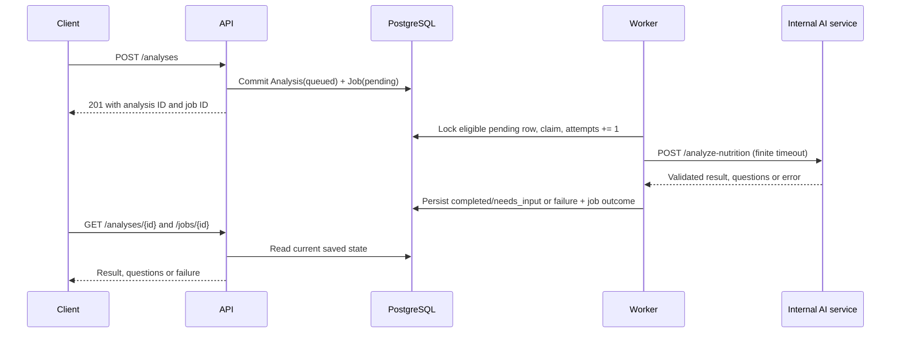

# NutriChat architecture

Current implementation reviewed: 2026-10-27.

The Qwen catalogue contains 138 USDA ingredient records and 250 project-authored
reference recipes. Expansion changes versioned data and validation, not model
weights or the database schema. The public deployment is older than this milestone.

## Services and data flow

```text
Browser -> [optional HTTPS proxy] -> FastAPI API + account sessions
                                                       | PostgreSQL
                                                       | analyses + jobs
                                                     Worker
                                                       | HTTP
                                                Internal AI service
                                                  |           |
                                             Qwen API    Python meal engine
                                                  |           |
                                              extraction   catalogue arithmetic
```

The API atomically saves an analysis and pending job. A separate worker claims the job, calls the internal AI service and persists the result or questions. The browser polls the API and renders saved state. PostgreSQL is the source of truth; localStorage remembers the last analysis ID per internal user ID for restoration.
Account/session tokens are never stored in localStorage.

- API: account sessions, authorization, private profiles/daily references, validation, revision/state checks, saved records, catalogue and HTML UI.
- Worker: asynchronous orchestration and job/error bookkeeping.
- AI service: Qwen extraction or legacy demo parsing, followed by deterministic evaluation.
- Shared meal engine: catalogue validation, questions, structured answers, assumptions and nutrient arithmetic.
- PostgreSQL: users, hashed sessions, account-owned analyses/cases, conversations, drafts, questions, evidence and jobs.

## Personal profile calculation

The authenticated API stores one current profile per user. A synchronous Python
calculator derives versioned energy and macro references without calling the worker,
AI service or Qwen. Profile input never joins meal-extraction prompts. Conditional
revision updates prevent stale tabs from overwriting newer data. Migration 0007
adds `user_profiles` without changing meals, accounts or sessions. No daily weight
log or trend aggregation is created; see [personalization](personalization.md).

## Qwen's role

Qwen runs in Alibaba Cloud Model Studio, not on ECS. It interprets Chinese descriptions, names, preparation, quantities and corrections and maps them to supported catalogue IDs. The adapter requests structured JSON, with `enable_thinking=false`, temperature 0 and a configurable model (default `qwen-plus`). Disabling deep-thinking mode does not remove language inference or guarantee correctness.

The model does not supply authoritative calorie/macronutrient values, approve recipes, or train on project updates. Python validates the extracted facts and calculates from the versioned catalogue. Structured question answers bypass another model call; natural-language replies use the bounded conversation as context. Updating aliases, food data or prompts changes application behavior without retraining model weights.

## Two modes and uncertainty

Basic mode applies labelled defaults to a calculation copy: reference portions, reference recipes and applicable extra-oil assumptions. The stored draft retains missing fields, so switching to advanced mode asks for details that were never supplied.

Advanced mode asks for grams, weight state, preparation and consumed oil as needed. Recipe calculations require explicit acceptance of editable ingredient quantities and finished batch yield. Unmatched foods or contradictory raw/cooked/preparation facts can require questions in either mode. Pending questions leave every nutrient total null.

Nutrients equal the sum of ingredient grams multiplied by their per-100g data. Recipe portions scale the whole-batch nutrients by consumed cooked weight divided by finished batch weight. Data provenance, limits and exceptions are detailed in [nutrition data](nutrition-data.md).

## Persistence and concurrency

Analysis states are `queued`, `needs_input`, `completed`, `failed`, `confirmed`. Jobs track `pending`, `claimed`, `completed`, `failed`. A question is a completed worker operation, not a failed job. User correction/reply/mode-switch requests check the current revision and state; confirmation locks completed records. The [API contract](api-contract.md) defines the payloads and transitions.

Alembic migrations add the analysis workflow, revision/confirmation fields (0003), JSON dialogue and evidence (0004), and mode (0005). Existing analyses receive `advanced` as their default mode. Migration 0006 adds users/sessions and nullable owners; old records remain ownerless
and inaccessible to account endpoints. API startup runs migrations before the worker starts.

## Deployment boundaries

Local Compose publishes development ports for API, AI and PostgreSQL. Cloud Compose exposes only API loopback access; AI and database remain internal. Optional public Compose adds Nginx on 80/443; authentication and ownership are enforced by the API. Secrets and certificates are external runtime files excluded from Git. See [cloud deployment](cloud-deployment.md).

The API readiness probe checks PostgreSQL. AI readiness reports service availability but does not call Qwen. Structured logging and Prometheus metrics support observation; they do not constitute end-to-end model validation.

## Current limitations

The `test` branch has independent accounts; the older public deployment is unchanged.
Personal profiles and approximate daily references are available on `test`.
Password recovery, Google login, daily weight logs and monthly trends are not implemented.
See [accounts](accounts.md) for session and ownership boundaries. There is no idempotency key, automatic retry, claimed-job recovery, image recognition, model training or measured cooking-loss model. Use one worker for this prototype. Reference recipes and portions are assumptions, and even detailed estimates depend on the quality of input and food mappings.

See [ADR 0001](adrs/0001-baseline-stack.md) for the starter stack and [ADR 0002](adrs/0002-source-backed-dual-mode.md) for the nutrition design.

## Week 6: worker contract and state ownership

The selected asynchronous step is meal interpretation and nutrition evaluation.
An external Qwen request has variable latency; the API validates/enqueues and returns
201 without waiting for it. The no-key demo provider exercises the same durable
worker path with deterministic input. See [the Week 6 evidence and workflow](async-workflow.md).



| Analysis / Job state | Owner | Entry condition and persisted evidence | API-visible meaning / next step |
| --- | --- | --- | --- |
| `queued` / `pending` | API | Valid input; both rows committed together; attempts 0 | Accepted, waiting for worker |
| `queued` / `claimed` | Worker | Pending job selected with `FOR UPDATE SKIP LOCKED`; claim time and attempts increment committed | Processing visible through Job; Analysis has no separate processing state |
| `completed` / `completed` | Worker | Valid complete result; all four totals and job completion timestamp saved | Ready for review; user may correct, switch mode or confirm |
| `needs_input` / `completed` | Worker | Draft/questions saved; all totals null; job completion timestamp saved | Clarification required, not a failed processing attempt |
| `failed` / `failed` | Worker | Caught exception; generic analysis error, bounded job error and completion timestamp saved | Correct/reply to enqueue a new job after resolving the cause |
| `queued` / new `pending` job | API | Revision/state checked correction, reply or mode switch; old totals cleared | New work; previous job remains historical evidence |
| `confirmed` / previous job unchanged | API | Current completed revision confirmed; timestamp saved | Locked; start another analysis for changes |

The client cannot directly set lifecycle states. The AI component receives only the
analysis ID, meal text, mode, bounded conversation and draft from the worker, and
returns structured extraction/evaluation results. It does not write analysis/job
rows or confirm user records. There is no scheduler in this implementation.

### Timeout, failure, retry and idempotency decisions

- Cloud Qwen timeout: 30 seconds; worker-to-AI timeout: 45 seconds. Local example
  defaults are 12/20 seconds; configurable values must preserve this ordering.
- Each job is attempted once. Timeout, HTTP error and malformed output are terminal
  failures; there is no `retry_wait`, retry delay or automatic retry budget.
- A user correction or reply creates a new job; it does not replay the failed job.
- A worker crash after claim can leave `claimed` indefinitely. Recovery is a
  documented gap; the polling loop only selects `pending`. There is no exactly-once guarantee.
- Idempotency keys are deferred beyond the Week 7 minimum. Repeated POST requests
  create distinct analyses/jobs and can incur duplicate work/provider usage.
- Analysis failures expose a generic message. No stable public error-code taxonomy
  exists yet. `/jobs/{id}` exposes bounded operational error text, so it must not be
  described as a fully sanitized error interface or multi-tenant production API.

### Week 7 demo and test plan

Demonstrate stopped-worker submission, saved queued/pending state, worker start,
claimed/completed job evidence, persisted nutrition and GET retrieval. Then show
clarification and confirmation on the Qwen path if configured. Use deadline-based
polling rather than a fixed long sleep. Capture HTTP responses, selected database
columns and matching job-ID logs separately.

The [workflow guide](async-workflow.md) maps the four minimum test categories to
actual test names, records evidence, and lists remaining gaps. The lab uses an
isolated Compose project so existing local and public demos keep running.

## Week 7 evidence

The [midterm artifact](../submissions/week07/README.md) records the current scope and
team responsibilities. A [fresh rehearsal](evidence/week07-verification.md) captures
real PostgreSQL writes, worker processing, persisted output, confirmation and
operational signals using the offline provider. Qwen observations are listed
separately; health checks alone do not establish provider correctness.
