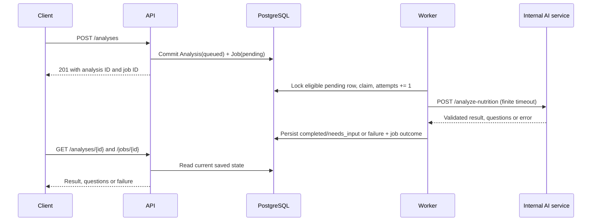

# NutriChat architecture

Current implementation reviewed: 2026-10-31, `nutrichat` branch.

The Qwen catalogue contains 200 USDA ingredient records and 350 project-authored
reference recipes. Expansion changes versioned data and validation, not model
weights or the database schema. The public deployment is older than this milestone.

## Services and data flow

```text
Browser -> [optional HTTPS proxy + session gateway] -> FastAPI API
                                                       | PostgreSQL
                                                       | analyses + jobs
                                                     Worker
                                                       | HTTP
                                                Internal AI service
                                                  |           |
                                             Qwen API    Python meal engine
                                                  |           |
                                              extraction   catalogue arithmetic
```

The API atomically saves an analysis and pending job. A separate worker claims the job, calls the internal AI service and persists the result or questions. The browser polls the API and renders saved state. PostgreSQL is the source of truth; localStorage remembers the last analysis ID for restoration and the browser's interface-language preference. It does not store the authoritative meal record or an account history.

- API: validation, revision/state checks, saved records, catalogue and HTML UI.
- Worker: asynchronous orchestration and job/error bookkeeping.
- AI service: Qwen extraction or legacy demo parsing, followed by deterministic evaluation.
- Shared meal engine: catalogue validation, questions, structured answers, assumptions and nutrient arithmetic.
- PostgreSQL: analyses, conversations, drafts, questions, evidence and jobs; historical cases remain available.

## Chinese and English interface

The header's **中文 / English** buttons change display language locally. The API
serves `/app` and an explicit allowlist of three JavaScript files under
`/app-assets/`: `catalogue-en.js`, `i18n.js` and `app.js`. These files are packaged
with the Python application, loaded in that order and served with `no-cache` so
the browser revalidates after an update. No frontend build service is required.

`i18n.js` translates controls, status messages, structured questions and evidence.
The English display catalogue retains names for the original 138 ingredients and
250 recipes, plus those recipes' reference methods. The 62 new ingredients and
100 new recipes prioritize Chinese; missing English mappings fall back to Chinese
names and methods. Catalogue search checks Chinese and available English display
names. User descriptions and free-form model notes retain their
original language. Display language is separate from matching: recognition is
restricted to recorded names and explicitly reviewed aliases, regardless of the
selected interface language.

A language change rerenders presentation while preserving unsent meal/reply text,
selected mode, question answers, editable recipe quantities/yield and acceptance.
It does not send a model request, create a job or modify the saved record's ID,
revision, state or nutrient values. Language selection remains usable when browser
storage is unavailable, but the preference then cannot persist across reloads.
See [the language verification record](evidence/ui-language-verification.md).

## Qwen's role

Qwen runs in Alibaba Cloud Model Studio, not on ECS. It interprets meal descriptions, names, preparation, quantities and corrections and maps them to supported catalogue IDs. Chinese meals are the primary product workflow; English descriptions also use this same extraction path. Interface language does not alter its prompt or improve food matching. The adapter requests structured JSON, with `enable_thinking=false`, temperature 0 and a configurable model (default `qwen-plus`). Disabling deep-thinking mode does not remove language inference or guarantee correctness.

The model does not supply authoritative calorie/macronutrient values, approve recipes, or train on project updates. Python validates the extracted facts and calculates from the versioned catalogue. Structured question answers bypass another model call; natural-language replies use the bounded conversation as context. Updating aliases, food data or prompts changes application behavior without retraining model weights.

The prompt receives a bounded shortlist instead of the entire growing catalogue.
`catalogue_candidates` selects up to 60 records using recorded name/alias spans
from the user's text and adds recipe ingredient context, with at most 120 records
in total. Retrieval only supplies interpretation context: substring candidates do
not authorize a match, and the separate identity guard below still decides whether
an extracted food corresponds to a complete supported user mention. Missing names
are not filled by a fuzzy nearest-dish search.

## Food identity boundary

The matching follow-up adds a deterministic identity check between model extraction
and nutrient calculation. The backend resolves each complete user-provided food
mention to a unique recorded name or reviewed alias. This exact lookup determines
the ID even if the model proposes a different one; it never selects the nearest
food. An existing catalogue ID alone is not evidence of a correct match.
Names copied from assistant suggestions or generated catalogue labels are not
independent user evidence. Similar-looking names or ingredient substrings must
not authorize a different dish.

Known-name matching accepts reviewed adjacent edible-state annotations such as
`已去骨` and `已去壳`. This narrow boundary rule does not authorize unknown dish
names, substitute another food or infer a gram quantity.

An unsupported or unverified match is retained as an unresolved item. The user
sees that no corresponding food record was found; no substitute dish, per-item
estimate or partial meal total is returned. The user can correct the name or use
the structured ingredient builder to select actual supported ingredients and
weights. Free-text ingredient recovery remains fallible and is not the reference
recovery route. Basic mode
may assume portions for a supported identity; it must not assume an identity for
an unsupported food. This stricter boundary can reject unlisted synonyms and is
not a guarantee that all remaining model facts are correct. Follow-up verification
is recorded separately from the earlier language-switch checks in
[the matching verification](evidence/food-matching-verification.md).

## Two modes and uncertainty

Basic mode applies labelled defaults to a calculation copy: reference portions, reference recipes and applicable extra-oil assumptions. The stored draft retains missing fields, so switching to advanced mode asks for details that were never supplied.

Advanced mode asks for grams, weight state, preparation and consumed oil as needed. Recipe calculations require explicit acceptance of editable ingredient quantities and finished batch yield. Unmatched foods or contradictory raw/cooked/preparation facts can require questions in either mode. Pending questions leave every nutrient total null.

Nutrients equal the sum of ingredient grams multiplied by their per-100g data. Recipe portions scale the whole-batch nutrients by consumed cooked weight divided by finished batch weight. Data provenance, limits and exceptions are detailed in [nutrition data](nutrition-data.md).

The [explicit ingredient builder](ingredient-recipes.md) can replace one unresolved
draft item with a user-accepted recipe. `POST /analyses/{id}/ingredients` validates
existing ingredient IDs, states shown for review, gram bounds and consumed/batch
basis. It preserves every other draft item and queues the normal worker with the
validated draft, so the calculation service does not call Qwen again. Model output
cannot supply `custom_recipe`; that field is created by the structured API path.
An unresolved item elsewhere still suppresses all totals. Custom calculations
retain their ingredient/portion provenance and are labelled separately from a
catalogue dish. Free-text replies are blocked for a meal containing custom recipes
to prevent re-extraction from discarding those facts; structured edits, clarification
answers, mode changes and final confirmation retain the ordinary revision rules.

## Persistence and concurrency

Analysis states are `queued`, `needs_input`, `completed`, `failed`, `confirmed`. Jobs track `pending`, `claimed`, `completed`, `failed`. A question is a completed worker operation, not a failed job. User correction/reply/mode-switch requests check the current revision and state; confirmation locks completed records. The [API contract](api-contract.md) defines the payloads and transitions.

Alembic migrations add the analysis workflow, revision/confirmation fields (0003), JSON dialogue and evidence (0004), and mode (0005). Existing analyses receive `advanced` as their default mode. API startup runs migrations before the worker starts.

## Deployment boundaries

Local Compose publishes development ports for API, AI and PostgreSQL. Cloud Compose exposes only API loopback access; AI and database remain internal. Optional public Compose adds Nginx on 80/443 and an internal session gateway. Secrets and certificates are external runtime files excluded from Git. See [cloud deployment](cloud-deployment.md).

The API readiness probe checks PostgreSQL. AI readiness reports service availability but does not call Qwen. Structured logging and Prometheus metrics support observation; they do not constitute end-to-end model validation.

## Current limitations

Food coverage is limited to 200 ingredient records and 350 reference recipes;
this is not a general food database. Unlisted foods, names and variants need
clarification or catalogue additions instead of a substitute estimate.

Local users open `/app` directly. Individual registration/login and per-user
record ownership are not implemented; the local **Log out** control has no
working authentication route. The optional public gateway is implemented in
`services/gateway/main.py`: it checks a shared username/password and signed
session cookies before Nginx proxies application requests. This is access control
for a shared demo, not an individual account system.

There is no idempotency key, automatic retry, claimed-job recovery, image
recognition, model training or measured cooking-loss model. Use one worker for
this prototype. Reference recipes and portions are assumptions, and even detailed
estimates depend on the quality of input and food mappings. Model extraction can
fail or propose a similar but incorrect food. The identity guard rejects
unverified food matches, but it does not prove that all quantities or cooking facts
are correct. Users must review interpreted foods and assumptions before confirming.

See [ADR 0001](adrs/0001-baseline-stack.md) for the starter stack and [ADR 0002](adrs/0002-source-backed-dual-mode.md) for the nutrition design.

## Week 6: worker contract and state ownership

The selected asynchronous step is meal interpretation and nutrition evaluation.
An external Qwen request has variable latency; the API validates/enqueues and returns
201 without waiting for it. The no-key demo provider exercises the same durable
worker path with deterministic input. See [the Week 6 evidence and workflow](async-workflow.md).



| Analysis / Job state | Owner | Entry condition and persisted evidence | API-visible meaning / next step |
| --- | --- | --- | --- |
| `queued` / `pending` | API | Valid input; both rows committed together; attempts 0 | Accepted, waiting for worker |
| `queued` / `claimed` | Worker | Pending job selected with `FOR UPDATE SKIP LOCKED`; claim time and attempts increment committed | Processing visible through Job; Analysis has no separate processing state |
| `completed` / `completed` | Worker | Valid complete result; all four totals and job completion timestamp saved | Ready for review; user may correct, switch mode or confirm |
| `needs_input` / `completed` | Worker | Draft/questions saved; all totals null; job completion timestamp saved | Clarification required, not a failed processing attempt |
| `failed` / `failed` | Worker | Caught exception; generic analysis error, bounded job error and completion timestamp saved | Correct/reply to enqueue a new job after resolving the cause |
| `queued` / new `pending` job | API | Revision/state checked correction, reply or mode switch; old totals cleared | New work; previous job remains historical evidence |
| `confirmed` / previous job unchanged | API | Current completed revision confirmed; timestamp saved | Locked; start another analysis for changes |

The client cannot directly set lifecycle states. The AI component receives only the
analysis ID, meal text, mode, bounded conversation and draft from the worker, and
returns structured extraction/evaluation results. It does not write analysis/job
rows or confirm user records. There is no scheduler in this implementation.

### Timeout, failure, retry and idempotency decisions

- Cloud Qwen timeout: 30 seconds; worker-to-AI timeout: 45 seconds. Local example
  defaults are 12/20 seconds; configurable values must preserve this ordering.
- Each job is attempted once. Timeout, HTTP error and malformed output are terminal
  failures; there is no `retry_wait`, retry delay or automatic retry budget.
- A user correction or reply creates a new job; it does not replay the failed job.
- A worker crash after claim can leave `claimed` indefinitely. Recovery is a
  documented gap; the polling loop only selects `pending`. There is no exactly-once guarantee.
- Idempotency keys are deferred beyond the Week 7 minimum. Repeated POST requests
  create distinct analyses/jobs and can incur duplicate work/provider usage.
- Analysis failures expose a generic message. No stable public error-code taxonomy
  exists yet. `/jobs/{id}` exposes bounded operational error text, so it must not be
  described as a fully sanitized error interface or multi-tenant production API.

### Week 7 demo and test plan

Demonstrate stopped-worker submission, saved queued/pending state, worker start,
claimed/completed job evidence, persisted nutrition and GET retrieval. Then show
clarification and confirmation on the Qwen path if configured. Use deadline-based
polling rather than a fixed long sleep. Capture HTTP responses, selected database
columns and matching job-ID logs separately.

The [workflow guide](async-workflow.md) maps the four minimum test categories to
actual test names, records evidence, and lists remaining gaps. The lab uses an
isolated Compose project so existing local and public demos keep running.

## Week 7 evidence

The [midterm artifact](../submissions/week07/README.md) records the current scope and
team responsibilities. A [fresh rehearsal](evidence/week07-verification.md) captures
real PostgreSQL writes, worker processing, persisted output, confirmation and
operational signals using the offline provider. Qwen observations are listed
separately; health checks alone do not establish provider correctness.

The 31 October language update passed 417 Python tests and 15 frontend DOM tests,
plus Ruff and a live Qwen browser flow covering editable recipe answers, language
switching, confirmation and reload. These later checks supplement the dated
milestone rehearsal; they do not change the original rehearsal's source version
or establish nutrition accuracy for real meals. The
[ingredient-builder verification](evidence/ingredient-recipe-verification.md)
records the subsequent `7c841b1` checks; the
[Chinese expansion verification](evidence/chinese-expansion-verification.md)
records the final expanded-catalogue checks. Historical results do not imply that
every newer commit or provider interpretation has passed the same live checks.
