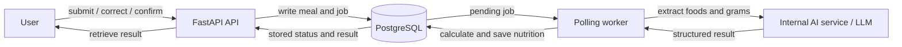

# NutriChat Architecture Proposal

## 1. Problem and Primary User

Our system helps adults estimate and record the calories and macronutrients in a meal without manually calculating each food's nutrition.

Primary user:
Adults who want a convenient, approximate food log and can provide food weights in grams.

## 2. Primary Workflow

1. The user submits one meal description with food weights in grams.
2. The API validates the input.
3. The API creates a `MealRecord` with status `queued`.
4. In the same transaction, it creates an `AnalysisJob` with status `pending` and returns both IDs.
5. The worker polls the database and claims the job.
6. The AI service extracts foods and grams; the worker matches references and calculates nutrients.
7. The worker saves the food items, completes the job, and marks the meal `ready_for_review`.
8. The user retrieves the result, optionally corrects foods or grams, and confirms the meal.

Exception path: processing fails -> the job and meal become `failed` -> the user sees the reason and can submit a corrected description as a new meal/job.

## 3. Architecture Diagram

The project extends the [course starter](https://github.com/Zr21340398/MAIE6000C-starter), retaining FastAPI, PostgreSQL, its polling worker, internal AI service, and Docker Compose. The first demo uses the existing API documentation interface.

## 4. Persistent Entities and Schema

| Table | Primary key | Important fields | Foreign keys |
|---|---|---|---|
| `meal_records` | `id` | original_text, status, confirmed_at | - |
| `analysis_jobs` | `id` | status, attempts, error, claimed_at, completed_at, model_version, prompt_version, input_fingerprint | meal_id -> meal_records.id (unique) |
| `food_items` | `id` | original_grams, grams, calories, protein, fat, carbs | meal_id -> meal_records.id; original_reference_id and reference_id -> nutrition_references.id |
| `nutrition_references` | `id` | food_name, source, source_food_id, dataset_version, nutrients_per_100g | - |

All tables include creation and update timestamps. The four per-100-g nutrient values use separate numeric fields. Each meal has one job and zero or more food items; a successful meal has at least one item. Original food selections and grams are preserved when users make corrections. Reference versions remain unchanged, and meal totals are calculated from saved items. Schema changes use reviewed Alembic migrations.

## 5. State Transitions

| Actor | Record | Allowed transition |
|---|---|---|
| API | Meal / Job | Create as `queued` / `pending` |
| Worker | Job | `pending -> claimed -> completed` or `failed` |
| Worker | Meal | `queued -> ready_for_review` or `failed` |
| User through API | Meal | `ready_for_review -> confirmed` |

Corrections are allowed only before confirmation and are saved with recalculated nutrients. Results and success states are committed together. Failed records retain the error; resubmission creates new records rather than resetting the old job. Only one worker runs; on restart, it marks abandoned claimed jobs failed before processing pending work.

## 6. Worker and AI Plan

The API stores work without calling the LLM. The worker reuses the starter's database-polling pattern and calls the internal AI service for structured food extraction. It validates the response, matches supported foods, calculates nutrition, and saves the result.

The AI extracts food identities and explicitly stated grams. Nutrition comes from a small offline subset of [USDA FoodData Central SR Legacy, April 2018](https://fdc.nal.usda.gov/download-datasets/). The team will verify the selected entries before implementation.

Calculation: `item nutrient = nutrient per 100 g * grams / 100`.

Missing grams, unsupported foods, invalid output, or model timeouts produce a visible failure. Model/prompt versions, input fingerprints, timestamps, and errors support traceability.

## 7. Risks and Scope Cuts

| Risk | Response |
|---|---|
| Incorrect food extraction | Use a small supported catalog and allow user correction |
| Missing quantity or unsupported food | Explain the failure and allow a new submission |
| Model access or reliability problems | Verify access early, set a timeout, and save failures |
| Limited development time | Use API docs for the demo and reduce food coverage |

The first scope cut is an optional custom frontend. Keep the core submit -> process -> persist -> retrieve -> confirm workflow. The first version is a single-user local demo; images, multi-turn chat, dashboards, accounts, and medical advice are outside scope.
